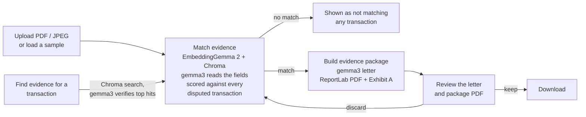

# Payment Intelligence

An all-in-one payment intelligence and treasury optimization dashboard for finance teams. It runs entirely on your
machine: a React frontend and a FastAPI backend in Docker, with local models served by Ollama. No data leaves
the machine and there are no third-party integrations.

The product has three modules. Each one is unlocked only after the one before it has been reviewed.

| Module | What it does | Status |
| --- | --- | --- |
| **Auto-Dispute Concierge** | Matches uploaded evidence to a card transaction and generates a legal chargeback package | **Live** |
| **Card Optimizer** | Recommends which corporate card to route a cross-border payment through, to clear SCA challenges and cut FX fees | **Live** |
| Liquidity Guard | Flags variable usage-based liabilities before they auto-debit | Locked (lock wall in UI, `423` from API) |

For the full blueprint (diagrams, data schemas, request flow, algorithms, API and configuration), see
**[docs/ARCHITECTURE.md](docs/ARCHITECTURE.md)**.

## How the Auto-Dispute Concierge works



The screen has two separate steps, so you can try many files before building anything:
**Match evidence** scores a file against the whole dispute queue, and **Build evidence package** writes the letter
and PDF for one matched transaction, which you review before deciding to download.

1. **Evidence in.** Drop a PDF, click **Use Sample PDF** to load a pre-built invoice from EUROSITES ADVERTISING
   LTD (USD 18,450.00, 12/09/2026) that backs transaction `txn_9f3a71c2`, or load any document from the
   **sample evidence library** (see below).
2. **Read.** A PDF's text layer is read with pypdf and split into chunks. **gemma3:4b** (vision-capable) reads the
   merchant, total amount, date, reference and a one-line description, from the PDF text or straight from a photo.
   For PDFs a value only counts if it also appears in the pypdf text, so the model can't invent a number. The
   reading is cached in Chroma, so each file is read once.
3. **Embed and store.** Each PDF chunk, or the JPEG image itself, is embedded with **EmbeddingGemma 2**
   (`embeddinggemma-2`). The model keeps nothing, so the vectors are saved in **Chroma**, an embedded vector
   store kept on a Docker volume. Files are keyed by the SHA-256 of their bytes: uploading the same file again,
   or re-scoring a sample, reuses the stored vectors instead of embedding again.
4. **Match (step 1).** The file is scored against every disputed transaction, ranked, and flagged as backing one
   of them or none. Each transaction is turned into five facets (merchant, amount, date, reference, purpose), which are
   embedded as queries on every match. A facets × chunks cosine-similarity matrix against the stored vectors gives
   a semantic score. For a photo, each facet is compared with the stored image vector relative to the rest of the
   queue. The semantic score is blended 60/40 with exact checks on amount (the document's total), date, merchant and
   invoice reference, giving a score and a verdict (STRONG, PARTIAL or WEAK). Evidence whose total doesn't match the
   transaction amount is never a match.
5. **Letter (step 2).** For the selected transaction (only PARTIAL or STRONG matches can be built), `gemma3:4b` writes a formal, aggressive chargeback letter to the card network, acting as a Senior
   Corporate Treasury Compliance Officer, with no chat filler.
6. **Package.** ReportLab stitches the transaction summary, match evidence, letter and ranked excerpts into one
   PDF, with the original evidence appended as Exhibit A.
7. **Review.** The letter appears in the preview pane first, with a tab for the full package PDF. Click
   **Download Legal Chargeback Package (PDF)** to keep it, or **Discard** to drop it.

Matching is a single request. Building runs as a background task; the UI polls the case and shows the letter and
PDF stages live.

### Sample evidence library

Eight generated documents (six PDFs and two JPEG "photos") show the matcher working in both directions. Load one
and click **Match evidence**, or select a transaction and use **Find evidence for this transaction** to search them
all.

| Sample | Type | Backs transaction |
| --- | --- | --- |
| EUROSITES Q4 campaign invoice | Invoice | `txn_9f3a71c2` EUROSITES ADV*LDN, USD 18,450.00 |
| Northwind SaaStr booth receipt | Receipt | `txn_51be08d4` SQ *NORTHWIND EVENTS, USD 7,200.00 |
| Datadog October invoice | Invoice | `txn_e4492fa0` DATADOG INC, USD 3,880.00 |
| Lumen Studio statement of work | Contract | `txn_2a6d93e7` PAYPAL *LUMENSTUDIO, USD 4,600.00 |
| EUROSITES Q2 invoice (old job) | Decoy | None: same merchant, different job, amount and date |
| Clerkenwell Hotel folio | Decoy | None: same card and week, unrelated spend |
| Northwind booth receipt (photo) | Receipt, JPEG | `txn_51be08d4`, matched as an image |
| London taxi receipt (photo) | Decoy, JPEG | None: same card, unrelated spend |

The Amazon transaction (`txn_c07e2b19`, card-absent fraud) deliberately has no supporting document.

## How the Card Optimizer works

The Card Optimizer takes a feed of cross-border card payments (some declined, some pending, some settled with
heavy fees) and recommends which card in the company's portfolio each one should go through.

1. **Normalise.** The feed is deliberately messy: alpha-3 country codes, lower-case currencies, amounts as strings
   with thousands separators. Everything is cleaned and converted to USD first.
2. **Corridor analysis (deterministic).** For each payment the engine works out the corridor (issuer country and
   region to merchant country and region), the friction it hit (SCA challenge from decline codes 1A/65 or 3DS text,
   regional block from codes 05/57/62, FX markup, cross-border fee) and, for every card, the fee it would cost and
   whether it could actually clear the friction.
3. **gemma3 recommendation.** The corridor facts, decline code and decline text go to gemma3 with a JSON schema, so
   the answer is always one of the reason codes below plus a card id from the portfolio, an action and a rationale.
   The app calls `OLLAMA_NIMBLE_PATH` (`/v1/systemone`) first; stock Ollama doesn't serve that path, so it falls
   back to Ollama's structured outputs on `/api/chat`. The route used is shown on each recommendation.
4. **Check and price.** The answer is compared with a rule engine. If the model picks a card that can't clear the
   friction, the rule's card is used and a warning is shown. Fees saved and payment volume recovered are always
   computed by the engine, never by the model. If Ollama is unavailable, the rule engine's answer is shown instead.

| Reason code | When |
| --- | --- |
| `SCA_BYPASS_CORRIDOR` | The payment hit a 3DS/SCA challenge; route it through a same-region card enrolled in the secure corporate payment exemption |
| `FX_INTERBANK_MATCH` | A card already holds the payment currency, so the FX markup disappears |
| `INTER-REGIONAL_ROUTING` | A regional block or cross-border fee can be avoided with a card issued in the merchant's region |
| `NO_CHANGE` | No card saves at least 10 USD, or nothing in the portfolio clears the friction |

## Local setup

Everything runs on your machine. The app runs in Docker; Ollama runs natively on the host so it can use your GPU
(on a Mac, Docker can't use the Apple Silicon GPU, so containerised Ollama would be much slower).

### 1. Prerequisites

| Tool | Version | Check |
| --- | --- | --- |
| [Docker Desktop](https://www.docker.com/products/docker-desktop/) (or Docker Engine + Compose v2) | Compose v2 | `docker compose version` |
| [Ollama](https://ollama.com/download) | recent enough to list `embeddinggemma-2` | `ollama --version` |
| Disk space for models | ~5 GB (gemma3:4b ≈ 3.3 GB, embeddinggemma-2 ≈ 1.3 GB) | |

### 2. Start Ollama and pull the models

```bash
# Start Ollama: open the Ollama app (macOS/Windows), or run:
ollama serve

# In another terminal:
ollama pull gemma3:4b          # reads fields from PDFs and photos, writes the letter
ollama pull embeddinggemma-2   # EmbeddingGemma 2: text + image embeddings for search and matching

# Confirm both models are installed and the API answers:
curl http://localhost:11434/api/tags
```

Use the default `embeddinggemma-2` tag (same as `:740m`) or `:440m`. The `:270m` and `:570m` tags are text-only,
so JPEG evidence would fail to match.

### 3. Get the code and configure (optional)

```bash
git clone https://github.com/rajatrao/payment_intelligence.git
cd payment_intelligence
cp .env.example .env   # optional: only needed to change models or the Ollama URL
```

The defaults work as-is: the backend container reaches Ollama on your host at
`http://host.docker.internal:11434`.

### 4. Run the app

```bash
docker compose up --build
```

| URL | What |
| --- | --- |
| http://localhost:3000 | Dashboard |
| http://localhost:8000/docs | Interactive API docs |
| http://localhost:8000/api/health | Ollama status and resolved models |

### 5. Verify the Ollama connection

- The badge at the top right of the dashboard turns **green** and shows both model names.
- Or check the API: `curl http://localhost:8000/api/health` should show `"reachable": true` with `llm_model` and
  `embed_model` filled in.
- Select a transaction and click **Search** under **Find evidence for this transaction**: the matching document
  should rank first.

### Troubleshooting

| Symptom | Fix |
| --- | --- |
| Badge red: "Ollama unreachable" | Make sure Ollama is running (`curl http://localhost:11434/api/tags`). If that works but the container still can't reach it, make Ollama listen on all interfaces and restart it. macOS: `launchctl setenv OLLAMA_HOST "0.0.0.0"`, then quit and reopen the Ollama app. Linux: `sudo systemctl edit ollama`, add `Environment="OLLAMA_HOST=0.0.0.0"` under `[Service]`, then `sudo systemctl restart ollama`. |
| Linux: `host.docker.internal` doesn't resolve | Already handled by `extra_hosts: host-gateway` in `docker-compose.yml`; make sure you're on Docker 20.10+. |
| Every photo scores the same, or "Ollama did not read the image" | Update Ollama, check `ollama show embeddinggemma-2` lists `vision`, then run `python3 scripts/check_image_embeddings.py` |
| `ollama pull` says "requires a newer version of Ollama" | Update Ollama (download the latest from ollama.com, or `brew upgrade ollama`), restart it, then pull again |
| Case fails: "Embedding model 'embeddinggemma-2' is not installed" | `ollama pull embeddinggemma-2` |
| JPEG case fails with an Ollama error | Check you're using an image-capable tag (default, `:740m` or `:440m`), and update Ollama. |
| Package says "Template letter", or the match panel shows no "read" values | gemma3 isn't installed: `ollama pull gemma3:4b`. Set `ALLOW_OFFLINE_FALLBACK=false` to fail instead of using the template letter. |
| Matching or letters are slow or time out | The first read of each file takes a few seconds on gemma3:4b; later matches use the cache. Raise `OLLAMA_TIMEOUT_SECONDS` in `.env` on slower machines. |
| Port 3000 or 8000 already in use | Change the left side of the `ports` mappings in `docker-compose.yml`. |

Matching requires EmbeddingGemma 2: if Ollama or the model is unavailable, the case fails with a clear error rather
than substituting another matcher. If only gemma3 is missing, PDFs still match on exact text checks, photos fall
back to the embedding alone, and the package is built with a clearly labelled template letter.

### Two-minute demo

1. Open the **Auto-Dispute Concierge** tab.
2. Load the **London hotel folio** decoy and click **Match evidence**: every transaction scores WEAK and the
   file is flagged as matching no disputed transaction. Try the taxi photo or the EUROSITES Q2 invoice too.
3. Click **Use Sample PDF**, then **Match evidence**. The EUROSITES transaction ranks first and is selected.
4. Click **Build evidence package**. Read the letter in the preview, switch to **Package PDF**, then click
   **Download Legal Chargeback Package (PDF)** or **Discard**.
5. Load another document (for example the Datadog invoice or the Northwind photo) and match again. For the photo,
   the match panel shows the amount and date gemma3 read from the image.
6. Select **SQ \*NORTHWIND EVENTS** in the queue and click **Search** under **Find evidence for this transaction**:
   Chroma shortlists stored files, gemma3 verifies them, and the receipt and its photo rank first. Click **Use** to
   load one.
7. Open the **Card Optimizer** tab. Select the declined **OVH** payment and click **Recommend route with gemma3**:
   it should come back as `SCA_BYPASS_CORRIDOR` on the Irish lodged card, with the payment amount recovered.
8. Click **Analyze all payments** to fill in the whole queue, then compare the header totals for fees paid,
   recovered volume and fees saved. The card options table shows why each card is or isn't eligible.
9. Click the Liquidity Guard tab to see the lock wall.

## Configuration

Copy `.env.example` to `.env` to override anything. The main settings:

| Variable | Default |
| --- | --- |
| `OLLAMA_BASE_URL` | `http://host.docker.internal:11434` |
| `OLLAMA_LLM_MODEL` | `gemma3:4b` (vision-capable: reads evidence fields and writes the letter) |
| `OLLAMA_EMBED_MODEL` | `embeddinggemma-2` (the only model used for matching; keep an image-capable tag: latest/`:740m` or `:440m`) |
| `OLLAMA_NIMBLE_PATH` | `/v1/systemone` (tried first by the Card Optimizer; falls back to `/api/chat` structured outputs if missing) |
| `ALLOW_OFFLINE_FALLBACK` | `true` (letter only: template letter if gemma3 is missing) |
| `CHROMA_DIR` | `/data/chroma` in Docker (named volume `chroma-data`); `/tmp/payment_intelligence/chroma` without Docker |

The full list is in [docs/ARCHITECTURE.md § 12](docs/ARCHITECTURE.md#12-configuration).

## Repository layout

```
.
├── docker-compose.yml          backend + frontend services
├── .env.example                configuration overrides
├── docs/ARCHITECTURE.md        architecture blueprint
├── scripts/                    check_image_embeddings.py: verify and tune image matching on real Ollama
├── backend/                    Python 3.12 · FastAPI
│   ├── Dockerfile              python:3.12-slim
│   ├── requirements.txt
│   └── app/
│       ├── main.py             routes, in-memory case store, async pipeline
│       ├── config.py           env-driven settings
│       ├── data/transactions/  mock transaction files: disputes, cross_border, recurring
│       └── services/           extraction, ollama_client, vector_store (Chroma), matching, letter,
│                               pdf_builder, samples, corridor (card engine), card_optimizer (gemma3)
└── frontend/                   React 18 · Vite · Tailwind CSS 3
    ├── Dockerfile              node build → nginx runtime
    ├── nginx.conf              serves the SPA, proxies /api to the backend
    └── src/
        ├── App.jsx             tab registry and routing
        ├── api.js              backend client
        ├── components/         Header, LockWall, Dropzone, PipelineStages, MatchPanel, Icons
        └── modules/            AutoDisputeConcierge, CardOptimizer
```

## API at a glance

| Method | Path | Purpose |
| --- | --- | --- |
| GET | `/api/disputes/transactions` | Mock transactions |
| GET | `/api/disputes/transactions/{id}/evidence-search` | Find stored files for a transaction (Chroma shortlist, gemma3 verify) |
| GET | `/api/disputes/samples` | Sample evidence library |
| GET | `/api/disputes/samples/{id}` | Sample PDF or JPEG (`?download=true` to download) |
| POST | `/api/disputes/evidence` | Step 1: match a file (`file`, or `sample_id`) against every disputed transaction |
| GET | `/api/disputes/evidence/{evidence_id}` | Stored match results for a file |
| POST | `/api/disputes/cases` | Step 2: build the letter and package (`transaction_id` + `evidence_id`) |
| GET | `/api/disputes/cases/{case_id}` | Poll case status and results |
| GET | `/api/disputes/cases/{case_id}/package.pdf` | Generated package (`?download=true` to download) |
| GET | `/api/card-optimizer/payments` | Card portfolio, analysed cross-border payments and any recommendations so far |
| POST | `/api/card-optimizer/payments/{id}/recommend` | Ask gemma3 for a reason code and card (checked against the rule engine) |
| * | `/api/liquidity-guard/*` | `423 Locked` |

## Local development without Docker

Use this for hot reload while editing code. Ollama setup (steps 1 and 2 above) is the same.

```bash
# Backend (needs Python 3.11+): http://localhost:8000
cd backend
python -m venv .venv && source .venv/bin/activate
pip install -r requirements.txt
OLLAMA_BASE_URL=http://localhost:11434 uvicorn app.main:app --reload

# Frontend, in another terminal (needs Node 18+): http://localhost:5173, proxies /api to :8000
cd frontend
npm install
npm run dev
```

## Current limitations

- Dispute cases and generated PDFs live in memory and are cleared when the backend restarts; only evidence
  embeddings persist (in Chroma). There is no case database yet; the schemas are documented in [docs/ARCHITECTURE.md § 7](docs/ARCHITECTURE.md#7-data-model-and-schemas).
- Not yet run against the real gemma3 and EmbeddingGemma 2 models or inside Docker. Development tests used a
  stand-in Ollama server, so real scores will differ.
- Image embedding uses `/api/embed` with `{"text": "", "image": <base64 JPEG>}` items. Ollama's model page doesn't
  document the image request format, so this needs confirming against a real Ollama install.
- Scoring weights, the image margin (`IMAGE_MARGIN`) and thresholds are hand-tuned; re-check them on real output
  with `scripts/check_image_embeddings.py`.
- No OCR engine: a scanned PDF has no text layer and isn't rasterised, so upload it as a JPEG to have gemma3 read
  it as a photo.
- Card Optimizer FX rates, card fees and the 10 USD saving threshold are mock values in
  `backend/app/data/transactions/cross_border.py`; recommendations are kept in memory.
- No authentication; this is a local demo.
- Stored vectors are tagged with the embedding model name and re-embedded if `OLLAMA_EMBED_MODEL` changes. To
  wipe them, run `docker compose down -v` (removes the `chroma-data` volume).
