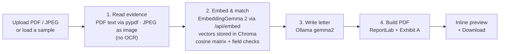

# Payment Intelligence

An all-in-one payment intelligence and treasury optimization dashboard for finance teams. It runs entirely on your
machine: a React frontend and a FastAPI backend in Docker, with local models served by Ollama. No data leaves
the machine and there are no third-party integrations.

The product has three modules. Each one is unlocked only after the one before it has been reviewed.

| Module | What it does | Status |
| --- | --- | --- |
| **Auto-Dispute Concierge** | Matches uploaded evidence to a card transaction and generates a legal chargeback package | **Live** |
| Smart-SCA Corridor Optimizer | Recommends routing around SCA challenges and FX fees | Locked (lock wall in UI, `423` from API) |
| Liquidity Guard | Flags variable usage-based liabilities before they auto-debit | Locked (lock wall in UI, `423` from API) |

For the full blueprint (diagrams, data schemas, request flow, algorithms, API and configuration), see
**[docs/ARCHITECTURE.md](docs/ARCHITECTURE.md)**.

## How the Auto-Dispute Concierge works



1. **Evidence in.** Drop a PDF, click **Use Sample PDF** to load a pre-built invoice from EUROSITES ADVERTISING
   LTD (USD 18,450.00, 12/09/2026) that backs transaction `txn_9f3a71c2`, or load any document from the
   **sample evidence library** (see below).
2. **Read.** A PDF's text layer is read with pypdf and split into chunks. A JPEG is not converted to text at all:
   there is no OCR, because EmbeddingGemma 2 embeds the image itself.
3. **Embed and store.** Each PDF chunk, or the JPEG image itself, is embedded with **EmbeddingGemma 2**
   (`embeddinggemma-2`). The model keeps nothing, so the vectors are saved in **Chroma**, an embedded vector
   store kept on a Docker volume. Files are keyed by the SHA-256 of their bytes: uploading the same file again,
   or re-scoring a sample, reuses the stored vectors instead of embedding again.
4. **Match.** The transaction is turned into five facets (merchant, amount, date, reference, purpose), which are
   embedded as queries on every match. A facets × chunks cosine-similarity matrix against the stored vectors gives
   a semantic score. For a JPEG, each facet is compared with the stored image vector. For PDFs the semantic score is
   blended 60/40 with exact checks on amount, date, merchant and invoice reference, giving a score and a verdict
   (STRONG, PARTIAL or WEAK).
5. **Letter.** `gemma2` writes a formal, aggressive chargeback letter to the card network, acting as a Senior
   Corporate Treasury Compliance Officer, with no chat filler.
6. **Package.** ReportLab stitches the transaction summary, match evidence, letter and ranked excerpts into one
   PDF, with the original evidence appended as Exhibit A.
7. **Review.** The PDF appears in an inline preview next to the transaction, with a
   **Download Legal Chargeback Package (PDF)** button.

The pipeline runs as a background task. The UI polls the case and shows each of the four stages live.

### Sample evidence library

Eight generated documents (six PDFs and two JPEG "photos") show the matcher working in both directions.
**Score all vs selected transaction** runs EmbeddingGemma 2 matching of the selected transaction against every
sample at once.

| Sample | Type | Backs transaction |
| --- | --- | --- |
| EUROSITES Q4 campaign invoice | Invoice | `txn_9f3a71c2` EUROSITES ADV*LDN, USD 18,450.00 |
| Northwind SaaStr booth receipt | Receipt | `txn_51be08d4` SQ *NORTHWIND EVENTS, USD 7,200.00 |
| Datadog October invoice | Invoice | `txn_e4492fa0` DATADOG INC, USD 3,880.00 |
| Lumen Studio statement of work | Contract | `txn_2a6d93e7` PAYPAL *LUMENSTUDIO, USD 4,600.00 |
| EUROSITES Q2 invoice (old job) | Decoy | None: same merchant, different job, amount and date |
| Clerkenwell Hotel folio | Decoy | None: same card and week, unrelated spend |
| Northwind booth receipt (photo) | Receipt, JPEG | `txn_51be08d4`, matched as an image |
| London taxi receipt (photo) | Decoy, JPEG | None: same card, unrelated spend |

The Amazon transaction (`txn_c07e2b19`, card-absent fraud) deliberately has no supporting document.

## Local setup

Everything runs on your machine. The app runs in Docker; Ollama runs natively on the host so it can use your GPU
(on a Mac, Docker can't use the Apple Silicon GPU, so containerised Ollama would be much slower).

### 1. Prerequisites

| Tool | Version | Check |
| --- | --- | --- |
| [Docker Desktop](https://www.docker.com/products/docker-desktop/) (or Docker Engine + Compose v2) | Compose v2 | `docker compose version` |
| [Ollama](https://ollama.com/download) | recent enough to list `embeddinggemma-2` | `ollama --version` |
| Disk space for models | ~3 GB (gemma2:2b ≈ 1.6 GB, embeddinggemma-2 ≈ 1.3 GB) | |

### 2. Start Ollama and pull the models

```bash
# Start Ollama: open the Ollama app (macOS/Windows), or run:
ollama serve

# In another terminal:
ollama pull gemma2:2b          # letter generation (gemma2:9b writes better letters but is slower)
ollama pull embeddinggemma-2   # EmbeddingGemma 2: text + image embeddings for matching

# Confirm both models are installed and the API answers:
curl http://localhost:11434/api/tags
```

Use the default `embeddinggemma-2` tag (same as `:740m`) or `:440m`. The `:270m` and `:570m` tags are text-only,
so JPEG evidence would fail to match.

### 3. Get the code and configure (optional)

```bash
git clone https://github.com/rajatrao/payment_intelligence.git
cd payment_intelligence
cp .env.example .env   # optional: only needed to change models or the Ollama URL
```

The defaults work as-is: the backend container reaches Ollama on your host at
`http://host.docker.internal:11434`.

### 4. Run the app

```bash
docker compose up --build
```

| URL | What |
| --- | --- |
| http://localhost:3000 | Dashboard |
| http://localhost:8000/docs | Interactive API docs |
| http://localhost:8000/api/health | Ollama status and resolved models |

### 5. Verify the Ollama connection

- The badge at the top right of the dashboard turns **green** and shows both model names.
- Or check the API: `curl http://localhost:8000/api/health` should show `"reachable": true` with `text_model` and
  `embed_model` filled in.
- In the sample library, click **Score all vs selected transaction**: the matching document should score highest.

### Troubleshooting

| Symptom | Fix |
| --- | --- |
| Badge red: "Ollama unreachable" | Make sure Ollama is running (`curl http://localhost:11434/api/tags`). If that works but the container still can't reach it, make Ollama listen on all interfaces and restart it. macOS: `launchctl setenv OLLAMA_HOST "0.0.0.0"`, then quit and reopen the Ollama app. Linux: `sudo systemctl edit ollama`, add `Environment="OLLAMA_HOST=0.0.0.0"` under `[Service]`, then `sudo systemctl restart ollama`. |
| Linux: `host.docker.internal` doesn't resolve | Already handled by `extra_hosts: host-gateway` in `docker-compose.yml`; make sure you're on Docker 20.10+. |
| Case fails: "Embedding model 'embeddinggemma-2' is not installed" | `ollama pull embeddinggemma-2` |
| JPEG case fails with an Ollama error | Check you're using an image-capable tag (default, `:740m` or `:440m`), and update Ollama. |
| Package says "Template letter" | gemma2 isn't installed: `ollama pull gemma2:2b`. Set `ALLOW_OFFLINE_FALLBACK=false` to fail instead of using the template. |
| Letters are slow or time out | Use `gemma2:2b` rather than `9b`, or raise `OLLAMA_TIMEOUT_SECONDS` in `.env`. |
| Port 3000 or 8000 already in use | Change the left side of the `ports` mappings in `docker-compose.yml`. |

Matching requires EmbeddingGemma 2: if Ollama or the model is unavailable, the case fails with a clear error rather
than substituting another matcher. If only gemma2 is missing, the package is still built with a clearly labelled
template letter.

### Two-minute demo

1. Open the **Auto-Dispute Concierge** tab.
2. Click **Score all vs selected transaction** in the sample library: the EUROSITES Q4 invoice scores highest,
   the decoys and other documents score low.
3. Click **Use Sample PDF**. The EUROSITES transaction is selected and the invoice appears in the preview.
4. Click **Match evidence & build package**. Watch the four stages complete and the match score appear.
5. Review the generated package in the preview, then click **Download Legal Chargeback Package (PDF)**.
6. Select another transaction (for example Datadog), score again, and load its matching document or a decoy.
7. Click the Card Optimizer and Liquidity Guard tabs to see the lock walls.

## Configuration

Copy `.env.example` to `.env` to override anything. The main settings:

| Variable | Default |
| --- | --- |
| `OLLAMA_BASE_URL` | `http://host.docker.internal:11434` |
| `OLLAMA_TEXT_MODEL` / `_FALLBACKS` | `gemma2:2b` / `gemma2:9b,gemma2` |
| `OLLAMA_EMBED_MODEL` | `embeddinggemma-2` (the only model used for matching; keep an image-capable tag: latest/`:740m` or `:440m`) |
| `OLLAMA_NIMBLE_PATH` | `/v1/systemone` (reserved for Card Optimizer and Liquidity Guard) |
| `ALLOW_OFFLINE_FALLBACK` | `true` (letter only: template letter if gemma2 is missing) |
| `CHROMA_DIR` | `/data/chroma` in Docker (named volume `chroma-data`); `/tmp/payment_intelligence/chroma` without Docker |

The full list is in [docs/ARCHITECTURE.md § 12](docs/ARCHITECTURE.md#12-configuration).

## Repository layout

```
.
├── docker-compose.yml          backend + frontend services
├── .env.example                configuration overrides
├── docs/ARCHITECTURE.md        architecture blueprint
├── backend/                    Python 3.12 · FastAPI
│   ├── Dockerfile              python:3.12-slim
│   ├── requirements.txt
│   └── app/
│       ├── main.py             routes, in-memory case store, async pipeline
│       ├── config.py           env-driven settings
│       ├── data/transactions/  mock transaction files: disputes, cross_border, recurring
│       └── services/           extraction, ollama_client, vector_store (Chroma), matching, letter,
│                               pdf_builder, samples
└── frontend/                   React 18 · Vite · Tailwind CSS 3
    ├── Dockerfile              node build → nginx runtime
    ├── nginx.conf              serves the SPA, proxies /api to the backend
    └── src/
        ├── App.jsx             tab registry and routing
        ├── api.js              backend client
        ├── components/         Header, LockWall, Dropzone, PipelineStages, MatchPanel, Icons
        └── modules/            AutoDisputeConcierge
```

## API at a glance

| Method | Path | Purpose |
| --- | --- | --- |
| GET | `/api/disputes/transactions` | Mock transactions |
| GET | `/api/disputes/samples` | Sample evidence library |
| GET | `/api/disputes/samples/{id}` | Sample PDF or JPEG (`?download=true` to download) |
| GET | `/api/disputes/samples/scores?transaction_id=…` | Match one transaction against every sample |
| POST | `/api/disputes/cases` | Start a case (`transaction_id` + `file`, or `transaction_id` + `sample_id`) |
| GET | `/api/disputes/cases/{case_id}` | Poll case status and results |
| GET | `/api/disputes/cases/{case_id}/package.pdf` | Generated package (`?download=true` to download) |
| * | `/api/card-optimizer/*`, `/api/liquidity-guard/*` | `423 Locked` |

## Local development without Docker

Use this for hot reload while editing code. Ollama setup (steps 1 and 2 above) is the same.

```bash
# Backend (needs Python 3.11+): http://localhost:8000
cd backend
python -m venv .venv && source .venv/bin/activate
pip install -r requirements.txt
OLLAMA_BASE_URL=http://localhost:11434 uvicorn app.main:app --reload

# Frontend, in another terminal (needs Node 18+): http://localhost:5173, proxies /api to :8000
cd frontend
npm install
npm run dev
```

## Current limitations

- Dispute cases and generated PDFs live in memory and are cleared when the backend restarts; only evidence
  embeddings persist (in Chroma). There is no case database yet; the schemas are documented in [docs/ARCHITECTURE.md § 7](docs/ARCHITECTURE.md#7-data-model-and-schemas).
- Not yet run against the real gemma2 and EmbeddingGemma 2 models or inside Docker. Development tests used a
  stand-in Ollama server, so real scores will differ.
- Image embedding uses `/api/embed` with `{"text": "", "image": <base64 JPEG>}` items. Ollama's model page doesn't
  document the image request format, so this needs confirming against a real Ollama install.
- Scoring weights, image score range and thresholds are hand-tuned and should be re-checked on real output.
- No OCR: a scanned PDF has no text layer, so upload it as a JPEG to have it matched as an image.
- No authentication; this is a local demo.
- Stored vectors are tagged with the embedding model name and re-embedded if `OLLAMA_EMBED_MODEL` changes. To
  wipe them, run `docker compose down -v` (removes the `chroma-data` volume).
