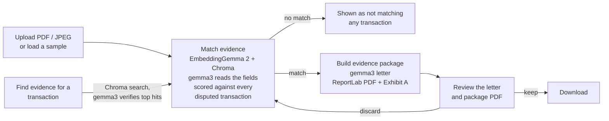

# Payment Intelligence

An all-in-one payment intelligence and treasury optimization dashboard for finance teams. It runs entirely on your
machine: a React frontend and a FastAPI backend in Docker, with local models served by Ollama. No data leaves
the machine and there are no third-party integrations.

**Demo video:** https://youtu.be/bzPNRtc_JCA

**Built with:** React 18 · Vite · Tailwind CSS · FastAPI · Python 3.12 · Chroma · ReportLab · Docker · Ollama

The product has three modules, all live.

| Module | What it does | Status |
| --- | --- | --- |
| **Auto-Dispute Concierge** | Matches uploaded evidence to a card transaction and generates a legal chargeback package | **Live** |
| **Card Optimizer** | Recommends which corporate card to route a cross-border payment through, to clear SCA challenges and cut FX fees | **Live** |
| **Liquidity Guard** | Flags variable usage-based liabilities (AWS, GCP, Meta Ads) before they auto-debit and forecasts each account's cash low point; forecasts a 30-day P10/P50/P90 cash corridor with Timestral | **Live** |

For the full blueprint (diagrams, data schemas, request flow, algorithms, API and configuration), see
**[docs/ARCHITECTURE.md](docs/ARCHITECTURE.md)**. The Card Optimizer and the Liquidity Guard, with their decision-API
requests, are detailed in **[docs/CARD_OPTIMIZER.md](docs/CARD_OPTIMIZER.md)** and
**[docs/LIQUIDITY_GUARD.md](docs/LIQUIDITY_GUARD.md)**.

## Models used

Every model runs locally and has one job, and every model answer is checked against a deterministic engine or rule
before it reaches the screen.

| Model | Served by | Used for |
| --- | --- | --- |
| **Gemma 3** (`gemma3:4b`) | Ollama | Auto-Dispute Concierge: reads merchant, amount, date and reference from PDFs and photos, and writes the chargeback letter |
| **EmbeddingGemma 2** (`embeddinggemma-2`) | Ollama | Auto-Dispute Concierge: embeds PDF text and photos for evidence search and transaction matching |
| **nimble** | Ollama decision API (`/v1/systemone`) | Card Optimizer: picks the reason code and card for each payment. Liquidity Guard: classifies each bill line as fixed or variable usage-based |
| **Timestral** (`mistralai/Timestral-209M`) | Inside the backend, on CPU | Liquidity Guard (Strategic Horizon Engine): 30-day P10/P50/P90 cash forecast per account |

## How the Auto-Dispute Concierge works



The screen has two separate steps, so you can try many files before building anything:
**Match evidence** scores a file against the whole dispute queue, and **Build evidence package** writes the letter
and PDF for one matched transaction, which you review before deciding to download.

1. **Evidence in.** Drop a PDF, click **Use Sample PDF** to load a pre-built invoice from EUROSITES ADVERTISING
   LTD (USD 18,450.00, 12/09/2026) that backs transaction `txn_9f3a71c2`, or load any document from the
   **sample evidence library** (six PDFs and two JPEG photos, including decoys that match nothing).
2. **Read.** A PDF's text layer is read with pypdf and split into chunks. **gemma3:4b** (vision-capable) reads the
   merchant, total amount, date, reference and a one-line description, from the PDF text or straight from a photo.
   For PDFs a value only counts if it also appears in the pypdf text, so the model can't invent a number. The
   reading is cached in Chroma, so each file is read once.
3. **Embed and store.** Each PDF chunk, or the JPEG image itself, is embedded with **EmbeddingGemma 2**
   (`embeddinggemma-2`). The model keeps nothing, so the vectors are saved in **Chroma**, an embedded vector
   store kept on a Docker volume. Files are keyed by the SHA-256 of their bytes: uploading the same file again,
   or re-scoring a sample, reuses the stored vectors instead of embedding again.
4. **Match (step 1).** The file is scored against every disputed transaction, ranked, and flagged as backing one
   of them or none. Each transaction is turned into five facets (merchant, amount, date, reference, purpose), which are
   embedded as queries on every match. A facets × chunks cosine-similarity matrix against the stored vectors gives
   a semantic score. For a photo, each facet is compared with the stored image vector relative to the rest of the
   queue. The semantic score is blended 60/40 with exact checks on amount (the document's total), date, merchant and
   invoice reference, giving a score and a verdict (STRONG, PARTIAL or WEAK). Evidence whose total doesn't match the
   transaction amount is never a match.
5. **Letter (step 2).** For the selected transaction (only PARTIAL or STRONG matches can be built), `gemma3:4b` writes a formal, aggressive chargeback letter to the card network, acting as a Senior
   Corporate Treasury Compliance Officer, with no chat filler.
6. **Package.** ReportLab stitches the transaction summary, match evidence, letter and ranked excerpts into one
   PDF, with the original evidence appended as Exhibit A.
7. **Review.** The letter appears in the preview pane first, with a tab for the full package PDF. Click
   **Download Legal Chargeback Package (PDF)** to keep it, or **Discard** to drop it.

Matching is a single request. Building runs as a background task; the UI polls the case and shows the letter and
PDF stages live.

## How the Card Optimizer works

The Card Optimizer takes a feed of cross-border card payments (some declined, some pending, some settled with
heavy fees) and recommends which card in the company's portfolio each one should go through.

1. **Normalise.** The feed is deliberately messy: alpha-3 country codes, lower-case currencies, amounts as strings
   with thousands separators. Everything is cleaned and converted to USD first.
2. **Corridor analysis (deterministic).** For each payment the engine works out the corridor (issuer country and
   region to merchant country and region), the friction it hit (SCA challenge from decline codes 1A/65 or 3DS text,
   regional block from codes 05/57/62, FX markup, cross-border fee) and, for every card, the fee it would cost and
   whether it could actually clear the friction.
3. **Decision model.** The raw payment (decline code and text, corridor) and a plain description of every card go to Ollama's decision API
   (`POST /v1/systemone`, Ollama 0.35+) running the `nimble` decision model. It answers two choice questions, which
   reason code and which card, with a probability for every option, so it can only ever return one of the codes
   below and a card from the portfolio. Nothing tells it the right answer: the judgement is the model's. The UI
   shows the probabilities. A decision model writes no text, so the
   action and rationale are filled in from the engine's facts.
4. **Compare and price.** The model's answer is shown as given, next to a rule engine's answer as a second
   opinion. Disagreements are highlighted, never overwritten. Fees saved and payment volume recovered are always
   computed by the engine, never by the model.
5. **Fallbacks.** If the decision API or `nimble` is missing, gemma3 makes the same choice through Ollama's
   structured outputs (`/api/chat` with a JSON schema). If Ollama is unavailable, the rule engine's answer is
   shown. Each recommendation shows the model and route used, and why a fallback was taken.

| Reason code | When |
| --- | --- |
| `SCA_BYPASS_CORRIDOR` | The payment hit a 3DS/SCA challenge; route it through a same-region card enrolled in the secure corporate payment exemption |
| `FX_INTERBANK_MATCH` | A card already holds the payment currency, so the FX markup disappears |
| `INTER-REGIONAL_ROUTING` | A regional block or cross-border fee can be avoided with a card issued in the merchant's region |
| `NO_CHANGE` | No card saves at least 10 USD, or nothing in the portfolio clears the friction |

## How the Liquidity Guard works

The Liquidity Guard looks at the vendor bills that will auto-debit the company's bank accounts in the next few days
and asks which of them are hiding a usage-based charge that is still growing.

1. **Bills and accounts.** Eleven October statements (AWS, Google Cloud, Meta Ads, Google Ads, LinkedIn, Snowflake,
   Twilio, Datadog, Slack, Salesforce and a coworking office), captured on 28 Oct with 27 of 31 days elapsed. Each
   bill debits one of three accounts: the operating account, the card settlement account and the marketing account.
   Each bill mixes fixed lines (seats, licences, commitments) with metered lines, and the line text is copied
   straight from the invoice.
2. **Decision model.** For each bill, one request goes to Ollama's decision API (`POST /v1/systemone`, model
   `nimble`) with one `noul` question per line: "Is this a variable usage-based consumption line?". Each question
   carries only the invoice line text, its last three charges and the amount billed so far. nimble returns a
   probability per line; 0.5 or more counts as variable. Nothing tells it the answer.
3. **Forecast (deterministic).** The classification decides how each line is forecast. A variable line's
   month-to-date amount is run-rated to the full cycle (amount × 31 / 27); a fixed line is charged as billed. A
   variable line forecast at more than 1.25× its three-cycle average is flagged as a spike.
4. **Accounts and cash timeline.** Each account card shows a donut of its bills that grows as they are classified.
   Every auto-debit, plus payroll and a known customer receipt, is laid on its account's timeline against that
   account's balance and minimum buffer. The UI shows each account's low point and the first day it falls below
   its buffer.
5. **Compare and fall back.** A keyword rule gives a second opinion on every line; disagreements are shown, never
   overwritten. If the decision API or nimble is missing, gemma3 answers true/false per line through structured
   outputs, and if Ollama is unavailable the rule's answer is used. Each bill shows the model and route used.

Before classification the forecast only counts what has been billed so far, and every account looks safe.
Classifying the bills shows the usage lines will keep growing to the end of the cycle: the card settlement account
drops below its buffer on 3 Nov and the marketing account on 6 Nov, while the operating account stays safe.

That is the **Tactical Ledger Guard** view. The **Strategic Horizon Engine** view, on the second tab on the left,
forecasts the same three accounts 30 days ahead, each against its minimum buffer as its floor:

1. **History and calendar.** 180 days of end-of-day balances per account (customer receipts, payroll on the 1st
   and 15th, the recurring bills on their debit days, top-ups between accounts and seasonal lulls) and a calendar
   of known-future covariates: payroll, bill and top-up days, month end, weekends and lulls.
2. **Timestral.** Mistral's time-series model (`mistralai/Timestral-209M`) runs inside the backend on CPU and
   returns quantiles for each of the next 30 days, for all three accounts in one batch. The 10th, 50th and 90th
   percentiles form an 80% safety corridor.
3. **Floor and sweep.** If an account's P10 falls below its floor, an alert names the day and recommends a
   pre-emptive sweep from the treasury money market, sized from the P10 shortfall. Executing it is simulated.
4. **Fallback.** If Timestral isn't installed, is still loading or is too slow, a statistical model computes the
   corridor instead, and the view says so in an amber banner.

## Local setup

Everything runs on your machine. The app runs in Docker; Ollama runs natively on the host so it can use your GPU
(on a Mac, Docker can't use the Apple Silicon GPU, so containerised Ollama would be much slower).

### 1. Prerequisites

| Tool | Version | Check |
| --- | --- | --- |
| [Docker Desktop](https://www.docker.com/products/docker-desktop/) (or Docker Engine + Compose v2) | Compose v2 | `docker compose version` |
| [Ollama](https://ollama.com/download) | 0.35 or newer (decision API for the Card Optimizer) | `ollama --version` |
| Disk space for models | ~15 GB (gemma3:4b ≈ 3.3 GB, embeddinggemma-2 ≈ 1.3 GB, nimble ≈ 9.4 GB) | |

### 2. Start Ollama and pull the models

```bash
# Start Ollama: open the Ollama app (macOS/Windows), or run:
ollama serve

# In another terminal:
ollama pull gemma3:4b          # reads fields from PDFs and photos, writes the letter
ollama pull embeddinggemma-2   # EmbeddingGemma 2: text + image embeddings for search and matching
ollama pull nimble             # decision model for the Card Optimizer (/v1/systemone)

# Confirm the models are installed and the API answers:
curl http://localhost:11434/api/tags
```

Use the default `embeddinggemma-2` tag (same as `:740m`) or `:440m`. The `:270m` and `:570m` tags are text-only,
so JPEG evidence would fail to match.

### 3. Get the code and configure (optional)

```bash
git clone https://github.com/rajatrao/payment_intelligence.git
cd payment_intelligence
cp .env.example .env   # optional: only needed to change models or the Ollama URL
```

The defaults work as-is: the backend container reaches Ollama on your host at
`http://host.docker.internal:11434`.

### 4. Run the app

```bash
docker compose up --build
```

The first build installs Timestral with CPU torch (a few hundred MB), and on first start the backend downloads the
`mistralai/Timestral-209M` weights from Hugging Face into the `hf-cache` volume in the background. Until they are
loaded, the Strategic Horizon view uses its statistical fallback and says so; `GET /api/health` shows
`forecast.status`. To build without Timestral, set `WITH_TIMESTRAL=false` in `.env`.

| URL | What |
| --- | --- |
| http://localhost:3000 | Dashboard |
| http://localhost:8000/docs | Interactive API docs |
| http://localhost:8000/api/health | Ollama status and resolved models |

### 5. Verify the Ollama connection

- The badge at the top right of the dashboard turns **green** and shows the model names.
- Or check the API: `curl http://localhost:8000/api/health` should show `"reachable": true` with `llm_model` and
  `embed_model` filled in (and `decision_model` for the Card Optimizer).
- Select a transaction and click **Search** under **Find evidence for this transaction**: the matching document
  should rank first.

## Configuration

Copy `.env.example` to `.env` to override anything. The main settings:

| Variable | Default |
| --- | --- |
| `OLLAMA_BASE_URL` | `http://host.docker.internal:11434` |
| `OLLAMA_LLM_MODEL` | `gemma3:4b` (vision-capable: reads evidence fields and writes the letter) |
| `OLLAMA_EMBED_MODEL` | `embeddinggemma-2` (the only model used for matching; keep an image-capable tag: latest/`:740m` or `:440m`) |
| `OLLAMA_NIMBLE_PATH` | `/v1/systemone` (Ollama's decision API, used by the Card Optimizer and the Liquidity Guard) |
| `OLLAMA_DECISION_MODEL` | `nimble` (decision model; if missing, gemma3 structured outputs are used instead) |
| `WITH_TIMESTRAL` | `true` (build arg: install Timestral and CPU torch in the backend image; `false` builds without it and the forecast uses its fallback) |
| `FORECAST_MODEL` | `mistralai/Timestral-209M` (Strategic Horizon forecast; weights cached on the `hf-cache` volume) |
| `FORECAST_TIMEOUT_SECONDS` | `20` (slower than this, the forecast uses the statistical fallback) |
| `ALLOW_OFFLINE_FALLBACK` | `true` (letter only: template letter if gemma3 is missing) |
| `CHROMA_DIR` | `/data/chroma` in Docker (named volume `chroma-data`); `/tmp/payment_intelligence/chroma` without Docker |

The full list is in [docs/ARCHITECTURE.md § 12](docs/ARCHITECTURE.md#12-configuration).

## Repository layout

```
.
├── docker-compose.yml          backend + frontend services
├── .env.example                configuration overrides
├── docs/                       ARCHITECTURE.md (blueprint), CARD_OPTIMIZER.md, LIQUIDITY_GUARD.md
├── scripts/                    checks against real Ollama: image embeddings, card and liquidity decisions
├── backend/                    Python 3.12 · FastAPI
│   ├── Dockerfile              python:3.12-slim
│   ├── requirements.txt
│   ├── requirements-forecast.txt   Timestral and CPU torch (installed in the image by default)
│   └── app/
│       ├── main.py             routes, in-memory case store, async pipeline
│       ├── config.py           env-driven settings
│       ├── data/transactions/  mock transaction files: disputes, cross_border, recurring, ledger
│       └── services/           extraction, ollama_client, vector_store (Chroma), matching, letter,
│                               pdf_builder, samples, corridor (card engine), card_optimizer (decision model),
│                               liquidity (forecast engine), liquidity_guard (line classification),
│                               horizon (Timestral 30-day forecast, fallback, sweep)
└── frontend/                   React 18 · Vite · Tailwind CSS 3
    ├── Dockerfile              node build → nginx runtime
    ├── nginx.conf              serves the SPA, proxies /api to the backend
    └── src/
        ├── App.jsx             tab registry and routing
        ├── api.js              backend client
        ├── components/         Header, LockWall, Donut, Dropzone, PipelineStages, MatchPanel, Icons
        └── modules/            AutoDisputeConcierge, CardOptimizer, LiquidityGuard, StrategicHorizon
```

## API at a glance

| Method | Path | Purpose |
| --- | --- | --- |
| GET | `/api/disputes/transactions` | Mock transactions |
| GET | `/api/disputes/transactions/{id}/evidence-search` | Find stored files for a transaction (Chroma shortlist, gemma3 verify) |
| GET | `/api/disputes/samples` | Sample evidence library |
| GET | `/api/disputes/samples/{id}` | Sample PDF or JPEG (`?download=true` to download) |
| POST | `/api/disputes/evidence` | Step 1: match a file (`file`, or `sample_id`) against every disputed transaction |
| GET | `/api/disputes/evidence/{evidence_id}` | Stored match results for a file |
| POST | `/api/disputes/cases` | Step 2: build the letter and package (`transaction_id` + `evidence_id`) |
| GET | `/api/disputes/cases/{case_id}` | Poll case status and results |
| GET | `/api/disputes/cases/{case_id}/package.pdf` | Generated package (`?download=true` to download) |
| GET | `/api/card-optimizer/payments` | Card portfolio, analysed cross-border payments and any recommendations so far |
| DELETE | `/api/card-optimizer/recommendations` | Clear all recommendations (the **Reset** button) |
| POST | `/api/card-optimizer/payments/{id}/recommend` | Ask the decision model for a reason code and card (checked against the rule engine) |
| GET | `/api/liquidity-guard/bills` | Upcoming bills with line forecasts, the cash timeline, totals and classifications so far |
| POST | `/api/liquidity-guard/bills/{id}/classify` | Ask the decision model which lines are variable usage-based (checked against the rule) |
| DELETE | `/api/liquidity-guard/classifications` | Clear all classifications (the **Reset** button) |
| GET | `/api/liquidity-guard/forecast?account_id=` | One account's 30-day P10/P50/P90 corridor, floor breach and recommended sweep, plus a summary of every account (also at `/api/liquidity/forecast`) |
| POST | `/api/liquidity-guard/forecast/sweep?account_id=` | Execute that account's recommended pre-emptive sweep (simulated) |
| DELETE | `/api/liquidity-guard/forecast` | Drop the sweeps and the cached forecast (the Strategic Horizon **Reset** button) |

## Local development without Docker

Use this for hot reload while editing code. Ollama setup (steps 1 and 2 above) is the same.

```bash
# Backend (needs Python 3.11+): http://localhost:8000
cd backend
python -m venv .venv && source .venv/bin/activate
pip install -r requirements.txt
pip install -r requirements-forecast.txt   # optional: Timestral for the Strategic Horizon forecast
OLLAMA_BASE_URL=http://localhost:11434 uvicorn app.main:app --reload

# Frontend, in another terminal (needs Node 18+): http://localhost:5173, proxies /api to :8000
cd frontend
npm install
npm run dev
```

## Tests

```bash
cd backend
pip install -r requirements-dev.txt
python -m pytest -q          # no Ollama needed: model calls are faked
python3 ../scripts/check_card_decisions.py        # with the app running: Card Optimizer on the real models
python3 ../scripts/check_liquidity_decisions.py   # with the app running: Liquidity Guard on the real models
python3 ../scripts/check_horizon.py               # with the app running: Strategic Horizon on Timestral
```

## Author

Built by **Rajat Rao** ([@rajatrao](https://github.com/rajatrao)).
