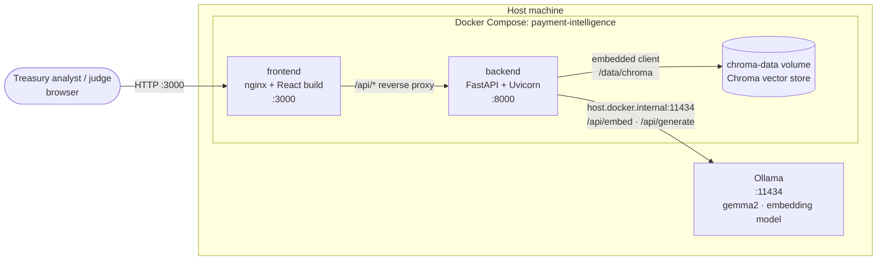
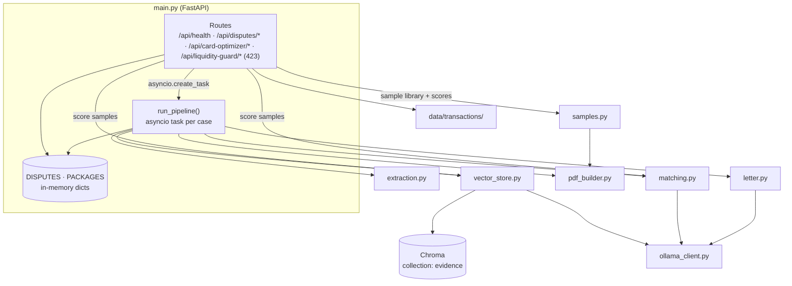
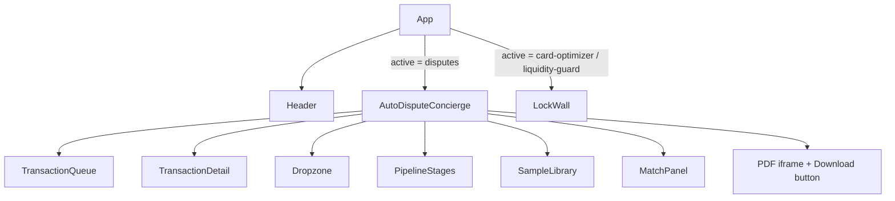
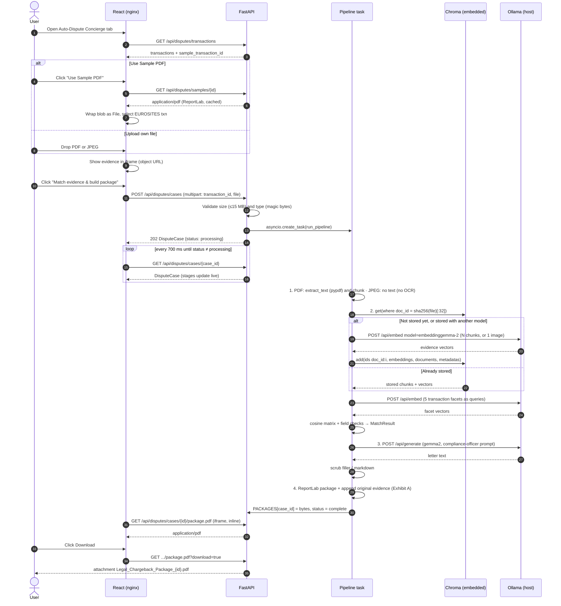
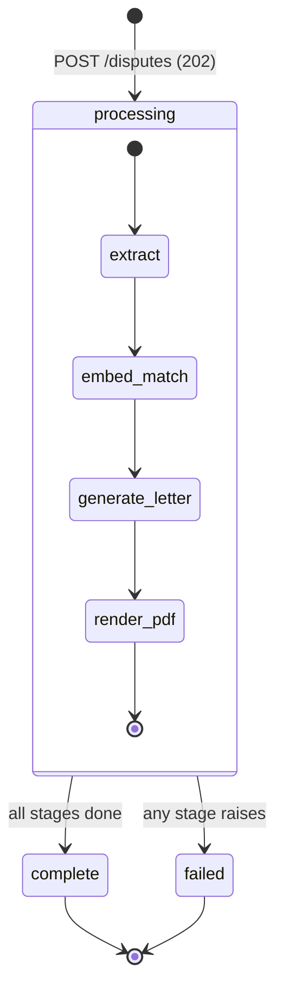
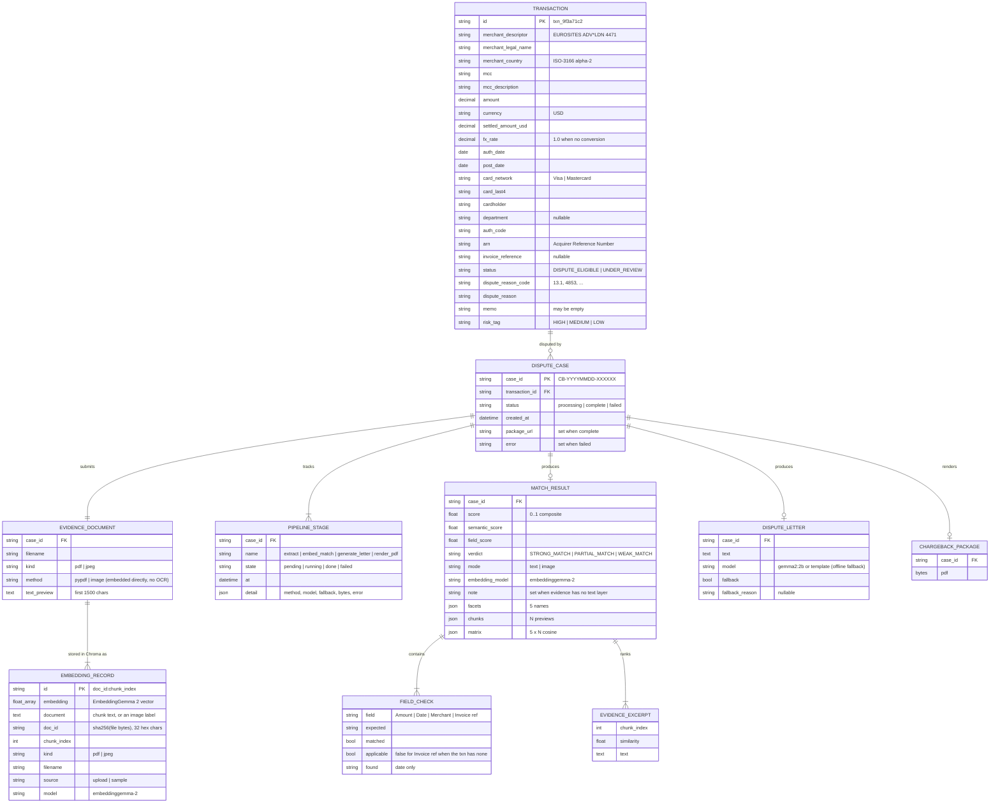
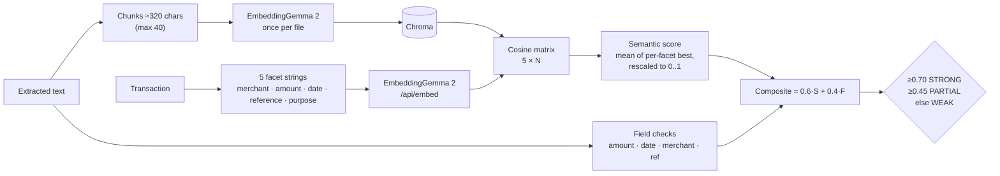

# Architecture Blueprint

This document describes the system as built for the **Auto-Dispute Concierge** module, plus the extension points
reserved for the **Card Optimizer** and **Liquidity Guard** modules. Diagrams are Mermaid and render on GitHub.

Contents

1. [System context](#1-system-context)
2. [Containers and runtime](#2-containers-and-runtime)
3. [Backend components](#3-backend-components)
4. [Frontend components](#4-frontend-components)
5. [Auto-Dispute Concierge end-to-end flow](#5-auto-dispute-concierge-end-to-end-flow)
6. [Dispute case lifecycle](#6-dispute-case-lifecycle)
7. [Data model and schemas](#7-data-model-and-schemas)
8. [Evidence matching algorithm](#8-evidence-matching-algorithm)
9. [Letter generation](#9-letter-generation)
10. [Chargeback package layout](#10-chargeback-package-layout)
11. [API reference](#11-api-reference)
12. [Configuration](#12-configuration)
13. [Failure modes and fallbacks](#13-failure-modes-and-fallbacks)
14. [Module gating (Card Optimizer and Liquidity Guard)](#14-module-gating-card-optimizer-and-liquidity-guard)
15. [Known limitations and review checklist](#15-known-limitations-and-review-checklist)

---

## 1. System context

Everything runs on one machine. No external services, no cloud storage, no third-party integrations.
Chroma runs embedded inside the backend process (no separate server) and writes to a Docker volume.
The only process outside Docker is Ollama, which runs on the host so it can use the host's GPU / Apple Silicon.



## 2. Containers and runtime

| Service | Image / build | Port (host:container) | Responsibility |
| --- | --- | --- | --- |
| `frontend` | `frontend/Dockerfile`: `node:20-alpine` build stage, `nginx:1.27-alpine` runtime | `3000:80` | Serves the static React bundle; proxies `/api/*` to `backend:8000` so the PDF iframe and downloads are same-origin (no CORS). 16 MB upload limit, 300 s proxy read timeout. |
| `backend` | `backend/Dockerfile`: `python:3.12-slim` | `8000:8000` | REST API, async dispute pipeline, PDF generation, mock data, embedded Chroma vector store. Health-checked at `/api/health`. |
| `chroma-data` (volume) | named Docker volume mounted at `/data/chroma` | none | Persists evidence embeddings across container restarts. `docker compose down -v` removes it. |
| Ollama (host) | not containerised | `11434` | Local models. Reached through `host.docker.internal` (`extra_hosts: host-gateway` makes this work on Linux as well as Docker Desktop). |

Startup order: `frontend` waits for `backend` to report healthy.

State: the backend is a **single process**. Dispute cases and generated packages live in memory and are cleared
on restart; evidence embeddings persist in Chroma on the `chroma-data` volume. See [section 7](#7-data-model-and-schemas).

## 3. Backend components

```
backend/app/
├── main.py                 FastAPI app, routes, in-memory stores, async pipeline orchestration
├── config.py               Settings dataclass (all env-driven)
├── data/
│   └── transactions/       Mock transaction files, named by feature
│       ├── disputes.py         Auto-Dispute Concierge dataset (live)
│       ├── cross_border.py     Card Optimizer dataset (provisioned, unused until unlocked)
│       └── recurring.py        Liquidity Guard dataset (provisioned, unused until unlocked)
└── services/
    ├── extraction.py       File-type detection, PDF text layer (pypdf, no OCR), chunking
    ├── ollama_client.py    Async Ollama client: EmbeddingGemma 2 text + image embeddings (single model), gemma2 generation
    ├── vector_store.py     Chroma collection "evidence": embed each document once, store and reuse its vectors
    ├── matching.py         Facet × stored-chunk cosine matrix, field checks, composite score
    ├── letter.py           Compliance-officer prompt, filler scrubbing, offline template letter
    ├── pdf_builder.py      ReportLab: EUROSITES invoice + legal chargeback package, Exhibit A merge (pypdf)
    └── samples.py          Sample evidence library: 5 documents that back a transaction, 3 decoys
```



Concurrency notes

- Each `POST /api/disputes/cases` returns `202` immediately and spawns one `asyncio` task.
- CPU-bound steps (text extraction, ReportLab rendering) run in worker threads via `asyncio.to_thread`, so the
  event loop keeps serving status polls.
- Embedding inputs are sent to `/api/embed` in batches of 16. Evidence already in Chroma is not re-embedded;
  only the five transaction facets are embedded on each match.
- Chroma calls are synchronous but local and small (one document's records), so they run inline.
- Task references are kept in `_TASKS` so they aren't garbage-collected mid-run.

## 4. Frontend components

```
frontend/src/
├── main.jsx / index.css        Entry, Tailwind layers (card, tag-green/amber/red, btn)
├── App.jsx                     MODULES registry + active-tab state; mounts module or LockWall
├── api.js                      Fetch wrappers for every backend route
├── components/
│   ├── Header.jsx              Brand, three tabs, live Ollama status badge (polls /api/health every 15 s)
│   ├── LockWall.jsx            Blurred skeleton + lock overlay for Card Optimizer and Liquidity Guard
│   ├── Dropzone.jsx            Drag-and-drop / click upload, PDF (text matched) or JPEG (image matched)
│   ├── SampleLibrary.jsx       Sample documents, Load / Download, "Score all vs selected transaction"
│   ├── PipelineStages.jsx      4-stage progress strip (pending / running / done / failed)
│   ├── MatchPanel.jsx          Score, sub-score bars, field checks, cosine heatmap
│   └── Icons.jsx               Inline SVG icons
└── modules/
    └── AutoDisputeConcierge.jsx   Auto-Dispute Concierge view: queue, detail, evidence, match, PDF preview
```



Auto-Dispute Concierge screen layout (desktop, `lg` breakpoint and up):

```
┌──────────────────────────── Header: brand · 3 tabs · Ollama badge ────────────────────────────┐
├───────────── Left 5/12 ─────────────┬──────────────────── Right 7/12 (sticky) ───────────────┤
│ Dispute queue (5 transactions)      │ Preview header (evidence name or case id + model)      │
│ Original transaction detail         │                                                        │
│ Evidence: dropzone                  │      <iframe> evidence PDF  ──►  chargeback package     │
│   [Use Sample PDF] [Match & build]  │                                                        │
│   Pipeline stages 1-4               │                                                        │
│ Evidence match: score, checks, heat │ [ Download Legal Chargeback Package (PDF) ]            │
└─────────────────────────────────────┴────────────────────────────────────────────────────────┘
```

Frontend state (all local `useState` in `AutoDisputeConcierge`):

| State | Meaning |
| --- | --- |
| `transactions`, `sampleTxnId` | Loaded once from `GET /api/disputes/transactions` |
| `selectedId` | Selected transaction (defaults to the sample transaction) |
| `file` | Evidence `File` (dropped, picked, or fetched from the sample endpoint) |
| `caseState` | Latest `DisputeCase` from polling |
| `busy`, `error` | Request in flight, last error |

The right pane shows, in priority order: generated package → local evidence PDF (object URL) → evidence image →
empty state. Selecting another transaction or file resets the case.

## 5. Auto-Dispute Concierge end-to-end flow



## 6. Dispute case lifecycle



Each stage moves `pending → running → done | failed` and records a timestamp plus detail (method, model,
fallback flag, byte count, or error). On failure, the stage that was running is marked `failed` and the case
carries the error string.

## 7. Data model and schemas

### Storage today

There is **no case database yet**. Evidence embeddings are persisted in Chroma; everything else is in memory:

| Store | Where | Lifetime |
| --- | --- | --- |
| Mock transactions | Python lists in `app/data/transactions/{disputes,cross_border,recurring}.py` | Static, read-only |
| Dispute cases | `DISPUTES: dict[case_id, DisputeCase]` in `main.py` | Until process restart |
| Generated packages | `PACKAGES: dict[case_id, bytes]` in `main.py` | Until process restart |
| Sample documents | `_cache` in `services/samples.py`, generated lazily (byte-stable: ReportLab `invariant=1`) | Until process restart |
| Evidence embeddings | Chroma collection `evidence` at `CHROMA_DIR` (`chroma-data` volume in Docker) | Persistent |

The schemas below are the contract the code uses today. The ER diagram also shows how they map to tables if
persistence is added later (suggested: SQLite or Postgres, PDFs on a volume or as blobs).

### Entity relationships



### Vector store (Chroma)

Implemented in `services/vector_store.py`. EmbeddingGemma 2 returns vectors and keeps nothing, so the backend
stores them in an embedded Chroma `PersistentClient` at `CHROMA_DIR`.

| Property | Value |
| --- | --- |
| Collection | `evidence`, cosine space (`hnsw:space: cosine`), no Chroma embedding function (vectors come from Ollama) |
| Record | One per PDF text chunk, or one per JPEG image. Id `"{doc_id}:{chunk_index}"` |
| Document key | `doc_id` = first 32 hex chars of the SHA-256 of the file bytes, so identical files share vectors |
| Metadata | `doc_id`, `chunk_index`, `kind`, `filename`, `source` (`upload` or `sample`), `model` |
| Reuse rule | Stored records are reused only if every record's `model` equals `OLLAMA_EMBED_MODEL`; otherwise they are deleted and the document is re-embedded |
| What is not stored | Transaction facets (queries). They are embedded on each match, so editing a transaction never leaves stale vectors |

Matching reads the document's stored vectors by `doc_id` and computes the facet × chunk matrix in Python. Chroma's
similarity search isn't needed for one document at a time, but the collection is ready for cross-document search
(for example "which stored evidence best fits this transaction") later. `/api/health` reports the record and
document counts under `vector_store`.

### JSON shapes

`DisputeCase`, as returned by `GET /api/disputes/cases/{case_id}`:

```json
{
  "case_id": "CB-20261027-B40DF6",
  "transaction_id": "txn_9f3a71c2",
  "status": "complete",
  "created_at": "2026-10-27T16:19:26.314176+00:00",
  "stages": {
    "extract":         { "state": "done", "at": "…", "method": "pypdf", "characters": 1532 },
    "embed_match":     { "state": "done", "at": "…", "model": "embeddinggemma-2",
                         "doc_id": "342e1037d829879d7325937bb091fb27", "vectors": "reused from Chroma" },
    "generate_letter": { "state": "done", "at": "…", "model": "gemma2:2b", "fallback": false },
    "render_pdf":      { "state": "done", "at": "…", "bytes": 9811 }
  },
  "evidence": { "filename": "EUROSITES_ADVERTISING_ESA-INV-2026-0912.pdf", "kind": "pdf",
                "method": "pypdf", "text_preview": "EUROSITES ADVERTISING LTD\nINVOICE…" },
  "match": {
    "score": 0.77, "semantic_score": 0.62, "field_score": 1.0, "verdict": "STRONG_MATCH", "note": null,
    "mode": "text", "embedding_model": "embeddinggemma-2",
    "doc_id": "342e1037d829879d7325937bb091fb27", "vectors_cached": true,
    "facets": ["merchant", "amount", "date", "reference", "purpose"],
    "chunks": ["EUROSITES ADVERTISING LTD\nINVOICE…", "…"],
    "matrix": [[0.48, 0.31, 0.22, 0.19, 0.27], "… 5 rows × N chunks"],
    "field_checks": [
      { "field": "Amount", "expected": "USD 18,450.00", "matched": true },
      { "field": "Date (within 7d of auth)", "expected": "2026-09-15", "matched": true, "found": "2026-09-12" },
      { "field": "Merchant", "expected": "EUROSITES ADVERTISING LTD", "matched": true },
      { "field": "Invoice ref", "expected": "ESA-INV-2026-0912", "matched": true }
    ],
    "top_evidence":     [{ "chunk_index": 0, "similarity": 0.48, "text": "…" }],
    "purpose_evidence": { "chunk_index": 3, "similarity": 0.48, "text": "…" }
  },
  "letter": { "text": "October 27, 2026\n\nVisa Dispute Resolution…", "model": "gemma2:2b", "fallback": false },
  "package_url": "/api/disputes/cases/CB-20261027-B40DF6/package.pdf"
}
```

### Mock datasets

| Dataset | Rows | Purpose |
| --- | --- | --- |
| `transactions/disputes.py` `DISPUTE_TRANSACTIONS` | 5 | Dispute-eligible card charges, all USD. Messy on purpose: descriptors differ from legal names (`SQ *`, `PAYPAL *`, `AMZN Mktp`), null department, `UNKNOWN` cardholder, empty memo, auth/post date drift. `txn_9f3a71c2` (EUROSITES, USD 18,450.00, 2026-09-15, Visa 13.1) matches the sample invoice. |
| `transactions/cross_border.py` `CROSS_BORDER_TRANSACTIONS` | 4 | Cross-border payments with SCA soft declines, decline codes, FX fee bps. Kept in local currencies because FX is the point of the Card Optimizer. |
| `transactions/recurring.py` `RECURRING_TRANSACTIONS` | 4 | Recurring liabilities (AWS, GCP, Meta Ads, Slack) with prior 3-month averages, mixing variable usage lines and fixed seats. |

### Sample evidence library

`services/samples.py` generates six PDFs with ReportLab and two JPEG "phone photos" with Pillow. Five back a
transaction; three are decoys built to look plausible (same merchant, or same card and week) but match nothing.

| Sample id | Document | Backs | Why it's interesting |
| --- | --- | --- | --- |
| `eurosites-invoice` | Invoice `ESA-INV-2026-0912`, 12/09/2026, USD 18,450.00 | `txn_9f3a71c2` | Service commitments (go-live 20 Sep, 4.5M impressions) prove non-delivery. Also served at `/api/disputes/sample-invoice`. |
| `northwind-receipt` | Square receipt `NW-8841`, 09/02/2026, USD 7,200.00 | `txn_51be08d4` | Promises a 20x20 booth with power; cardholder got 10x10 without. |
| `datadog-invoice` | Invoice `DD-77120-OCT`, 2026-10-01, USD 3,880.00 | `txn_e4492fa0` | States the account is on a prepaid annual plan: supports duplicate processing. |
| `lumen-sow` | SOW `LS-2026-118`, 2026-08-24, USD 4,600.00 | `txn_2a6d93e7` | Contracts a 90s film plus three cutdowns. |
| `eurosites-q2-invoice` | Invoice `ESA-INV-2026-0611`, USD 9,800.00 | none | Same merchant, different job, amount and date. Merchant check passes, nothing else. |
| `hotel-folio` | Hotel folio, London, 14 to 16 Sep 2026, USD 1,286.40 | none | Same card and week as the EUROSITES charge, unrelated spend. |
| `northwind-photo` | JPEG photo of the Northwind receipt, USD 7,200.00 | `txn_51be08d4` | Exercises image matching. |
| `taxi-photo` | JPEG photo of a London taxi receipt, USD 48.20, 15/09/2026 | none | Image decoy on the same card. |

`txn_c07e2b19` (Amazon, card-absent fraud) has no document on purpose.

## 8. Evidence matching algorithm

Implemented in `services/matching.py`.



1. **Facets.** The transaction becomes five short natural-language strings, so each can find its own best
   matching passage (the amount lives in the totals table, the merchant in the header, and so on).
2. **Chunks.** Extracted text is split on lines into ~320-character chunks, up to 40.
3. **Matrix.** Chunks are embedded with EmbeddingGemma 2 (the only embedding model; there is no substitute) once
   per file and stored in Chroma; facets are embedded on every match. `matrix[i][j] = cos(facet_i, chunk_j)`. Facets use the retrieval query prompt
   `task: search result | query: …` and chunks the document prompt `title: none | text: …`.
4. **Semantic score.** For each facet take its best chunk, rescale `(s − 0.2) / 0.6` clamped to 0..1, then
   average.
5. **Field checks** (deterministic, catch what embeddings blur):
   - Amount: several formats (`18,450.00`, `18450.00`, `18 450.00`, `18.450,00`).
   - Date: any date 0 to 7 days before the auth date, in ISO, `dd/mm/yyyy`, `mm/dd/yyyy` and long forms.
   - Merchant: at least 50% of the legal-name tokens (4+ letters, minus `ltd/inc/llc/corp`) appear.
   - Invoice ref: exact substring. Skipped (shown as N/A) when the transaction has no reference.
6. **Composite** = `0.6 × semantic + 0.4 × (checks passed / applicable checks)`.
7. **Evidence ranking.** Chunks ranked by their strongest facet similarity; the top 4 go into the package.
   The chunk most similar to the *purpose* facet is quoted in the letter.

**Image evidence (JPEG).** EmbeddingGemma 2 maps text and images into one vector space, so a JPEG is embedded
as an image (`/api/embed` input item `{"text": "", "image": <base64 JPEG, max 1024 px>}`) and the matrix is
5 facets × 1 image. Cross-modal cosines run lower, so the rescale range is `(s − 0.1) / 0.4`. Field checks need
text and are shown as N/A, so the image score is the semantic score alone (`mode: "image"`, weight 1.0).
The image request shape comes from community usage; Ollama's model page doesn't document it, so confirm it on a
real install. A text-only tag (`:270m`, `:570m`) will make image cases fail with Ollama's error.

A scanned PDF has no text layer and is not rasterised; the matrix runs against a placeholder, the score is near
zero, and `note` suggests uploading it as a JPEG instead.

Scores have not yet been measured with real EmbeddingGemma 2. In development, a stand-in embedding server ranked
the correct PDF first for every transaction that has one, with the decoys scoring low; the stand-in can't judge
images. Re-check the thresholds and image range once the real model is running.

## 9. Letter generation

Implemented in `services/letter.py`, routed to `POST /api/generate`.

| Part | Content |
| --- | --- |
| System prompt | Senior Corporate Treasury Compliance Officer persona. Hard rules: letter body only, no markdown, no invented facts, no placeholders, firm and aggressive tone, cite reason code and ARN, refer to evidence as Exhibit A, 300 to 450 words. |
| User prompt | Addressee (`{network} Dispute Resolution, Chargeback Arbitration Unit`), every transaction field, match score and field-check results, strongest purpose excerpt, top 3 excerpts, fixed signature block. |
| Options | `temperature 0.25`, `num_ctx 8192`, `stream false`. |
| Post-processing | Regexes strip opening filler ("Sure,", "Here is the…:"), trailing filler ("Let me know…"), and `* # \`` characters and bullet markers. |
| Model chain | `OLLAMA_TEXT_MODEL` → each of `OLLAMA_TEXT_MODEL_FALLBACKS`; a 404 (model not installed) moves to the next. |
| Offline fallback | `template_letter()`: a deterministic five-paragraph letter from the same facts. Flagged in the stage detail, the UI ("Template letter" tag) and the PDF. |

## 10. Chargeback package layout

Built by `build_chargeback_package()` (ReportLab Platypus, A4) then merged with pypdf.

| Page | Content |
| --- | --- |
| 1 | Header (title, case id, generated timestamp, reason code). Disputed transaction table. Evidence match box (score coloured green / amber / red, verdict, sub-scores, embedding model). Field-check table. Cardholder statement. |
| 2 | Chargeback argument letter (Times 11 pt), with a fallback note if the template was used. |
| 3 | Matched evidence excerpts ranked by similarity, with source file and extraction method. |
| 4+ | Exhibit A: the original evidence. PDF pages are appended as-is; a JPEG is embedded as a scaled image. |

Every page has a footer with the case id, "CONFIDENTIAL", the letter model and the page number.

The sample documents are built with the same style helpers (`build_sample_invoice()` and `services/samples.py`).

## 11. API reference

Interactive docs: http://localhost:8000/docs

| Method | Path | Description | Response |
| --- | --- | --- | --- |
| GET | `/api/health` | Ollama reachability, resolved models, config, Chroma record/document counts | JSON |
| GET | `/api/modules` | Module registry with lock state and messages | JSON |
| GET | `/api/disputes/transactions` | All dispute transactions and the sample transaction id | JSON |
| GET | `/api/disputes/transactions/{id}` | One transaction | JSON / 404 |
| GET | `/api/disputes/samples` | Sample library metadata and default sample id | JSON |
| GET | `/api/disputes/samples/scores?transaction_id=…` | EmbeddingGemma 2 match of one transaction against every sample (no letter or PDF) | JSON; 503 if Ollama/model unavailable |
| GET | `/api/disputes/samples/{id}` | Sample PDF or JPEG, inline (`?download=true` for attachment) | `application/pdf` or `image/jpeg` / 404 |
| GET | `/api/disputes/samples/{id}/text` | Extracted text of a sample | JSON |
| GET | `/api/disputes/sample-invoice` | Alias of the EUROSITES sample | `application/pdf` |
| POST | `/api/disputes/cases` | Start a case. Multipart: `transaction_id` (required), and `file` (PDF/JPEG) **or** `sample_id` (`use_sample=true` = EUROSITES) | `202` DisputeCase; 400 / 404 / 413 / 415 |
| GET | `/api/disputes/cases/{case_id}` | Poll case status | DisputeCase / 404 |
| GET | `/api/disputes/cases/{case_id}/package.pdf` | Generated package, inline (`?download=true` for attachment) | `application/pdf` / 404 until ready |
| GET, POST | `/api/card-optimizer/*`, `/api/liquidity-guard/*` | Locked modules | `423 {"locked": true, "detail": "…"}` |

## 12. Configuration

All settings are environment variables, read in `config.py` and passed through `docker-compose.yml`
(override with a `.env` file; see `.env.example`).

| Variable | Default | Used by |
| --- | --- | --- |
| `OLLAMA_BASE_URL` | `http://host.docker.internal:11434` | All Ollama calls |
| `OLLAMA_TEXT_MODEL` | `gemma2:2b` | Letter generation |
| `OLLAMA_TEXT_MODEL_FALLBACKS` | `gemma2:9b,gemma2` | Letter generation |
| `OLLAMA_EMBED_MODEL` | `embeddinggemma-2` | Matching, text and image (only model used; no fallback) |
| `OLLAMA_NIMBLE_PATH` | `/v1/systemone` | Reserved for Card Optimizer and Liquidity Guard |
| `OLLAMA_TIMEOUT_SECONDS` | `180` | All Ollama calls |
| `ALLOW_OFFLINE_FALLBACK` | `true` | Letter only: `false` fails the case instead of using the template letter |
| `CHROMA_DIR` | `/tmp/payment_intelligence/chroma` (`/data/chroma` in Docker, on the `chroma-data` volume) | Chroma vector store |
| `STORAGE_DIR` | `/tmp/payment_intelligence` | Reserved scratch directory |
| `CORS_ORIGINS` | `http://localhost:5173,http://localhost:3000` | Direct browser → backend calls in dev |
| `VITE_API_PROXY` (frontend dev) | `http://localhost:8000` | Vite dev-server proxy target |

## 13. Failure modes and fallbacks

| Situation | Behaviour | Visible where |
| --- | --- | --- |
| Ollama unreachable | Stage 2 fails: "Ollama is unreachable at …". Sample scoring returns 503. | Header badge red, red stage, error banner |
| EmbeddingGemma 2 not installed (404) | Stage 2 fails: "Run: ollama pull embeddinggemma-2". No substitute embedder. | Header badge amber, red stage, error banner |
| gemma2 not installed (404) | Next tag in `OLLAMA_TEXT_MODEL_FALLBACKS`, then the template letter | Stage 3 shows the model used; "Template letter" tag; PDF footer and note |
| `ALLOW_OFFLINE_FALLBACK=false` and no gemma2 | Stage 3 fails; the case goes to `failed` | Red stage, error banner |
| JPEG evidence | Embedded as an image; field checks N/A; `note` explains | Amber note in the match panel |
| Model tag can't embed images, or Ollama rejects the image request | Stage 2 fails with Ollama's error text | Red stage, error banner |
| Scanned PDF (no text layer) | Score near zero; `note` suggests uploading as JPEG; still attached as Exhibit A | Amber note in the match panel |
| Malformed evidence PDF | Text extraction returns empty; Exhibit A merge is skipped, the package still renders | Stage 1 detail |
| Wrong file type | `415` before any processing | Error banner |
| File over 15 MB | `413` | Error banner |
| Backend restart | All cases and packages lost; stored embeddings survive in Chroma | Package URL returns 404 |
| `OLLAMA_EMBED_MODEL` changed | Stored vectors from the old model are ignored, deleted and re-embedded on next use | Stage 2 shows "embedded and stored in Chroma" |
| Same file uploaded again | Vectors reused, only facets embedded | Stage 2 shows "reused from Chroma" |

## 14. Module gating (Card Optimizer and Liquidity Guard)

Locking is enforced in both layers:

- **UI.** `MODULES` in `App.jsx` marks the Card Optimizer and Liquidity Guard `locked`. Their tabs show a lock icon and mount `LockWall`
  (blurred skeleton plus overlay) with their lock messages.
- **API.** A catch-all route returns `423 Locked` for any `/api/card-optimizer/*` or `/api/liquidity-guard/*` path.

Reserved for the locked modules, not wired yet:

- `OLLAMA_NIMBLE_PATH=/v1/systemone` for structured-JSON primitives.
- Card Optimizer reason codes `SCA_BYPASS_CORRIDOR`, `FX_INTERBANK_MATCH`, `INTER-REGIONAL_ROUTING` (only shown as
  decoration in the lock wall).
- Liquidity Guard boolean classification "variable usage-based consumption line".
- Mock datasets in `data/transactions/cross_border.py` and `data/transactions/recurring.py`.

To unlock a module: add its service module and routes, remove its key from `LOCKS` in `main.py`, set
`locked: false` in `App.jsx`, and mount its view.

## 15. Known limitations and review checklist

Limitations

- Cases and packages are in memory (only embeddings persist); one backend process; no auth (local demo).
- Chroma is embedded, so only one backend process should write to `CHROMA_DIR` at a time.
- Not yet run against real gemma2 / EmbeddingGemma 2 or in Docker; development used a stand-in Ollama server.
- The 0.6 / 0.4 weights, rescale ranges and verdict thresholds are hand-tuned, not calibrated on EmbeddingGemma 2.
- The image-embedding request format is unconfirmed against Ollama's documentation.
- Chunking is line-based; complex invoice layouts may split related fields across chunks.
- No OCR by design: JPEGs are matched as images; scanned PDFs are not rasterised.
- Headless browsers don't render PDFs in iframes; desktop Chrome, Safari and Firefox do.

Suggested review points

1. The Ollama defaults (`config.py`, `.env.example`): EmbeddingGemma 2 only for matching, gemma2 tags for letters.
2. The system prompt tone and hard rules (`letter.py`, `SYSTEM_PROMPT`).
3. Scoring weights and thresholds (`matching.py`).
4. Mock data realism (`data/transactions/`) and the sample documents (`services/samples.py`, `pdf_builder.py`).
5. The package layout (`pdf_builder.py`, `build_chargeback_package`).
6. Whether the Card Optimizer should keep foreign-currency data.
