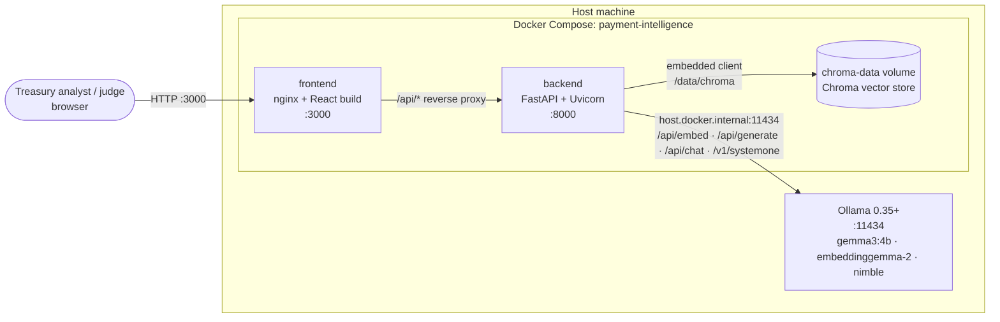
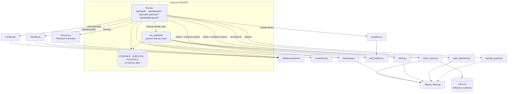
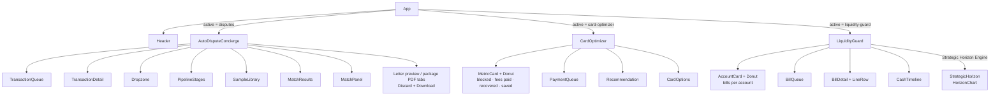
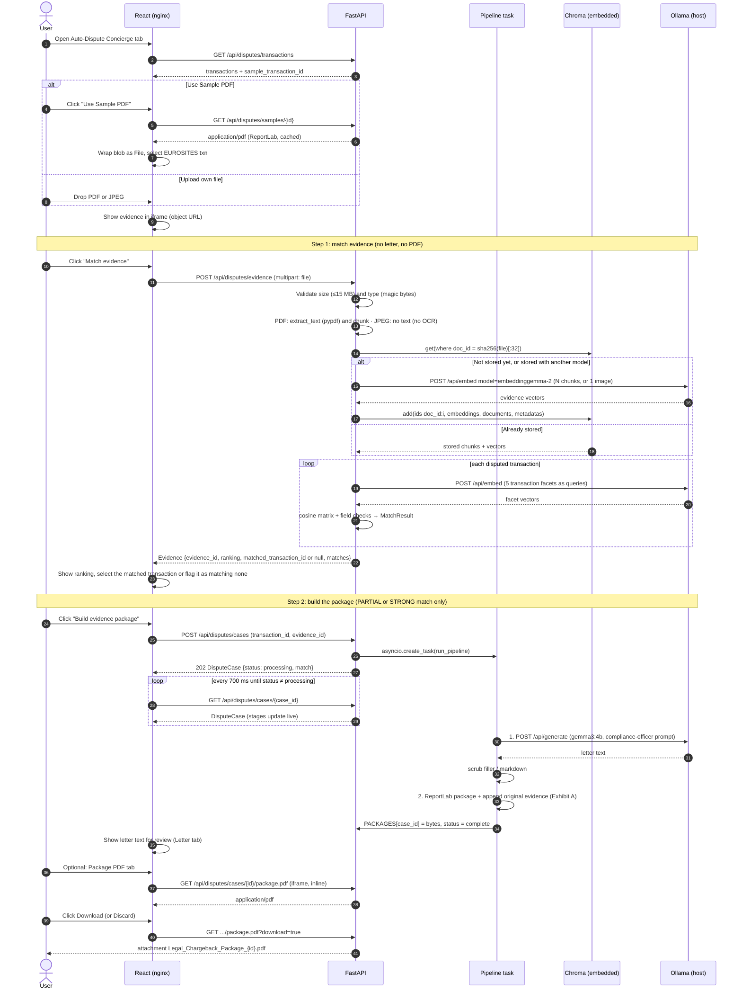
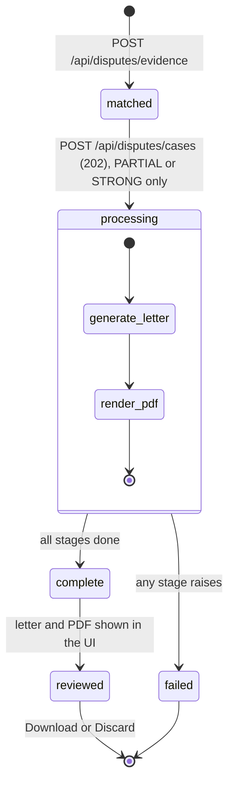
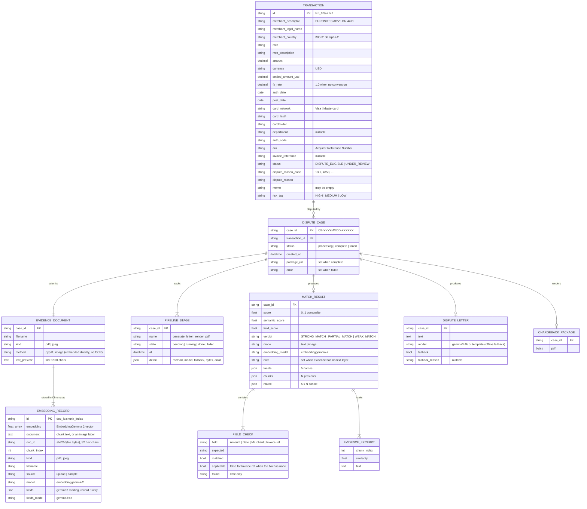
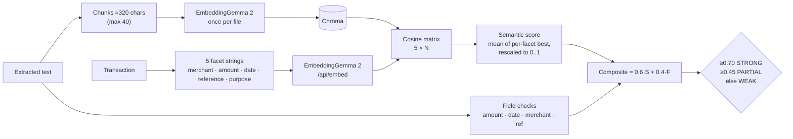
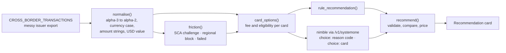
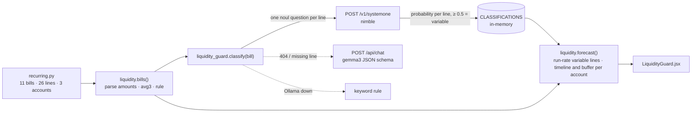

# Architecture Blueprint

This document describes the system as built for the **Auto-Dispute Concierge**, **Card Optimizer** and
**Liquidity Guard** modules. Diagrams are Mermaid and render on GitHub.

Contents

1. [System context](#1-system-context)
2. [Containers and runtime](#2-containers-and-runtime)
3. [Backend components](#3-backend-components)
4. [Frontend components](#4-frontend-components)
5. [Auto-Dispute Concierge end-to-end flow](#5-auto-dispute-concierge-end-to-end-flow)
6. [Dispute case lifecycle](#6-dispute-case-lifecycle)
7. [Data model and schemas](#7-data-model-and-schemas)
8. [Evidence matching algorithm](#8-evidence-matching-algorithm)
9. [Letter generation](#9-letter-generation)
10. [Chargeback package layout](#10-chargeback-package-layout)
11. [API reference](#11-api-reference)
12. [Configuration](#12-configuration)
13. [Failure modes and fallbacks](#13-failure-modes-and-fallbacks)
14. [Card Optimizer and module gating](#14-card-optimizer-and-module-gating)
15. [Liquidity Guard](#15-liquidity-guard)

---

## 1. System context

Everything runs on one machine. No external services, no cloud storage, no third-party integrations.
Chroma runs embedded inside the backend process (no separate server) and writes to a Docker volume.
The only process outside Docker is Ollama, which runs on the host so it can use the host's GPU / Apple Silicon.



## 2. Containers and runtime

| Service | Image / build | Port (host:container) | Responsibility |
| --- | --- | --- | --- |
| `frontend` | `frontend/Dockerfile`: `node:20-alpine` build stage, `nginx:1.27-alpine` runtime | `3000:80` | Serves the static React bundle; proxies `/api/*` to `backend:8000` so the PDF iframe and downloads are same-origin (no CORS). 16 MB upload limit, 300 s proxy read timeout. |
| `backend` | `backend/Dockerfile`: `python:3.12-slim` | `8000:8000` | REST API, async dispute pipeline, PDF generation, mock data, embedded Chroma vector store. Health-checked at `/api/health`. |
| `chroma-data` (volume) | named Docker volume mounted at `/data/chroma` | none | Persists evidence embeddings across container restarts. `docker compose down -v` removes it. |
| Ollama (host) | not containerised | `11434` | Local models. Reached through `host.docker.internal` (`extra_hosts: host-gateway` makes this work on Linux as well as Docker Desktop). |

Startup order: `frontend` waits for `backend` to report healthy.

State: the backend is a **single process**. Dispute cases and generated packages live in memory and are cleared
on restart; evidence embeddings persist in Chroma on the `chroma-data` volume. See [section 7](#7-data-model-and-schemas).

## 3. Backend components

```
backend/app/
├── main.py                 FastAPI app, routes, in-memory stores, async pipeline orchestration
├── config.py               Settings dataclass (all env-driven)
├── data/
│   └── transactions/       Mock transaction files, named by feature
│       ├── disputes.py         Auto-Dispute Concierge dataset (live)
│       ├── cross_border.py     Card Optimizer dataset and card portfolio (live)
│       ├── recurring.py        Liquidity Guard dataset: upcoming bills, three bank accounts, cash flows (live)
│       └── ledger.py           Strategic Horizon dataset: 180-day reserve ledger and 30-day calendar covariates
└── services/
    ├── extraction.py       File-type detection, PDF text layer (pypdf, no OCR), chunking
    ├── ollama_client.py    Async Ollama client: EmbeddingGemma 2 embeddings, gemma3 letters and JSON, nimble decisions
    ├── fields.py           gemma3:4b reads merchant, total, date, reference, description from PDF text or a photo
    ├── vector_store.py     Chroma collection "evidence": embed each document once, store and reuse its vectors
    ├── matching.py         Facet × stored-chunk cosine matrix, field checks, composite score
    ├── letter.py           Compliance-officer prompt, filler scrubbing, offline template letter
    ├── pdf_builder.py      ReportLab: EUROSITES invoice + legal chargeback package, Exhibit A merge (pypdf)
    ├── samples.py          Sample evidence library: 5 documents that back a transaction, 3 decoys
    ├── corridor.py         Card Optimizer engine: normalise, corridor, friction, per-card fees, rule recommendation
    ├── card_optimizer.py   Decision-model recommendation (nimble), gemma3 and rule fallbacks
    ├── liquidity.py        Liquidity Guard engine: line rule, run-rate forecast, cash timeline, buffer breach
    ├── liquidity_guard.py  Decision-model line classification (nimble noul), gemma3 and rule fallbacks
    └── horizon.py          Strategic Horizon: Timestral 30-day P10/P50/P90 forecast, statistical fallback, sweep
```



Concurrency notes

- `POST /api/disputes/evidence` runs inline: it embeds the file once (or reuses Chroma) and embeds 5 facets per
  disputed transaction.
- Each `POST /api/disputes/cases` returns `202` immediately and spawns one `asyncio` task (letter, then PDF).
- CPU-bound steps (text extraction, ReportLab rendering) run in worker threads via `asyncio.to_thread`, so the
  event loop keeps serving status polls.
- Embedding inputs are sent to `/api/embed` in batches of 16. Evidence already in Chroma is not re-embedded;
  only the five transaction facets are embedded on each match.
- Chroma calls are synchronous but local and small (one document's records), so they run inline.
- Task references are kept in `_TASKS` so they aren't garbage-collected mid-run.

## 4. Frontend components

```
frontend/src/
├── main.jsx / index.css        Entry, Tailwind layers (card, tag-green/amber/red, btn)
├── App.jsx                     MODULES registry + active-tab state; mounts the module, or LockWall if locked
├── api.js                      Fetch wrappers for every backend route
├── components/
│   ├── Header.jsx              Brand, three tabs, live Ollama status badge (polls /api/health every 15 s)
│   ├── LockWall.jsx            Blurred skeleton + lock overlay for a locked module (none today)
│   ├── Dropzone.jsx            Drag-and-drop / click upload, PDF (text matched) or JPEG (image matched)
│   ├── SampleLibrary.jsx       Sample documents, Load / Download
│   ├── EvidenceSearch.jsx      "Find evidence for this transaction": Chroma shortlist verified by gemma3
│   ├── MatchResults.jsx        Step 1 result: the file ranked against every disputed transaction
│   ├── PipelineStages.jsx      Build progress strip: letter, PDF (pending / running / done / failed)
│   ├── MatchPanel.jsx          Score, sub-score bars, field checks, cosine heatmap
│   ├── Donut.jsx               Distribution donut (fixed colour per entity, animates on change)
│   └── Icons.jsx               Inline SVG icons
└── modules/
    ├── AutoDisputeConcierge.jsx   Auto-Dispute Concierge view: queue, detail, evidence, match, PDF preview
    ├── CardOptimizer.jsx          Card Optimizer view: metric donuts, payment queue, recommendation, card options
    ├── LiquidityGuard.jsx         Liquidity Guard: Tactical Ledger Guard / Strategic Horizon Engine toggle; tactical view: totals, account donuts, bill queue, line classifications, cash timeline
    └── StrategicHorizon.jsx       Strategic Horizon Engine: corridor chart, floor, breach alert, sweep, daily values
```



Auto-Dispute Concierge screen layout (desktop, `lg` breakpoint and up):

```
┌──────────────────────────── Header: brand · 3 tabs · Ollama badge ────────────────────────────┐
├───────────── Left 5/12 ─────────────┬──────────────────── Right 7/12 (sticky) ───────────────┤
│ 1 · Evidence: dropzone              │ Preview header (file, or case id + [Letter|Package])   │
│   [Use Sample PDF] [Match evidence] │                                                        │
│ Match results: all transactions     │   evidence PDF / image  ──►  letter  ⇄  package PDF     │
│ 2 · Build: score, checks, heatmap   │                                                        │
│   [Build evidence package] stages   │                                                        │
│ Dispute queue · transaction detail  │                                                        │
│ Sample evidence library             │ [Discard] [ Download Legal Chargeback Package (PDF) ]  │
└─────────────────────────────────────┴────────────────────────────────────────────────────────┘
```

Frontend state (all local `useState` in `AutoDisputeConcierge`):

| State | Meaning |
| --- | --- |
| `transactions`, `sampleTxnId` | Loaded once from `GET /api/disputes/transactions` |
| `selectedId` | Selected transaction (defaults to the sample transaction) |
| `file` | Evidence `File` (dropped, picked, or fetched from the sample endpoint) |
| `evidence` | Step 1 result from `POST /api/disputes/evidence` (ranking + per-transaction matches) |
| `caseState` | Latest `DisputeCase` from polling |
| `view` | Review tab: `letter` or `package` |
| `matching`, `busy`, `error` | Match in flight, build in flight, last error |

The right pane shows, in priority order: built package (letter or PDF tab) → local evidence PDF (object URL) →
evidence image → empty state. A new file clears the match results; selecting another transaction keeps them
(they cover every transaction) and only clears the built package. **Discard** clears the package.

## 5. Auto-Dispute Concierge end-to-end flow



## 6. Dispute case lifecycle



Matching is not a case: it is a synchronous request whose result is kept in `EVIDENCE` (in memory, latest 50
files) so a case can reuse it by `evidence_id`. A case only has the two build stages. Each stage moves `pending → running → done | failed` and records a timestamp plus detail (method, model,
fallback flag, byte count, or error). On failure, the stage that was running is marked `failed` and the case
carries the error string.

## 7. Data model and schemas

### Storage today

There is **no case database yet**. Evidence embeddings are persisted in Chroma; everything else is in memory:

| Store | Where | Lifetime |
| --- | --- | --- |
| Mock transactions | Python lists in `app/data/transactions/{disputes,cross_border,recurring}.py` | Static, read-only |
| Match results | `EVIDENCE: dict[evidence_id, Evidence]` in `main.py` (latest 50 files, with bytes and per-transaction matches) | Until process restart |
| Dispute cases | `DISPUTES: dict[case_id, DisputeCase]` in `main.py` | Until process restart |
| Generated packages | `PACKAGES: dict[case_id, bytes]` in `main.py` | Until process restart |
| Sample documents | `_cache` in `services/samples.py`, generated lazily (byte-stable: ReportLab `invariant=1`) | Until process restart |
| Evidence embeddings | Chroma collection `evidence` at `CHROMA_DIR` (`chroma-data` volume in Docker) | Persistent |

The schemas below are the contract the code uses today. The ER diagram also shows how they map to tables if
persistence is added later (suggested: SQLite or Postgres, PDFs on a volume or as blobs).

### Entity relationships



### Vector store (Chroma)

Implemented in `services/vector_store.py`. EmbeddingGemma 2 returns vectors and keeps nothing, so the backend
stores them in an embedded Chroma `PersistentClient` at `CHROMA_DIR`.

| Property | Value |
| --- | --- |
| Collection | `evidence`, cosine space (`hnsw:space: cosine`), no Chroma embedding function (vectors come from Ollama) |
| Record | One per PDF text chunk, or one per JPEG image. Id `"{doc_id}:{chunk_index}"` |
| Document key | `doc_id` = first 32 hex chars of the SHA-256 of the file bytes, so identical files share vectors |
| Metadata | `doc_id`, `chunk_index`, `kind`, `filename`, `source` (`upload` or `sample`), `model` |
| Reuse rule | Stored records are reused only if every record's `model` equals `OLLAMA_EMBED_MODEL`; otherwise they are deleted and the document is re-embedded |
| What is not stored | Transaction facets (queries). They are embedded on each match, so editing a transaction never leaves stale vectors |

Matching reads the document's stored vectors by `doc_id` and computes the facet × chunk matrix in Python. Chroma's
similarity search isn't needed for one document at a time, but the collection is ready for cross-document search
(for example "which stored evidence best fits this transaction") later. `/api/health` reports the record and
document counts under `vector_store`.

### JSON shapes

`DisputeCase`, as returned by `GET /api/disputes/cases/{case_id}`:

```json
{
  "case_id": "CB-20261027-B40DF6",
  "transaction_id": "txn_9f3a71c2",
  "evidence_id": "342e1037d829879d7325937bb091fb27",
  "status": "complete",
  "created_at": "2026-10-27T16:19:26.314176+00:00",
  "stages": {
    "generate_letter": { "state": "done", "at": "…", "model": "gemma3:4b", "fallback": false },
    "render_pdf":      { "state": "done", "at": "…", "bytes": 9811 }
  },
  "evidence": { "filename": "EUROSITES_ADVERTISING_ESA-INV-2026-0912.pdf", "kind": "pdf",
                "method": "pypdf", "text_preview": "EUROSITES ADVERTISING LTD\nINVOICE…" },
  "match": {
    "score": 0.77, "semantic_score": 0.62, "field_score": 1.0, "verdict": "STRONG_MATCH", "note": null,
    "mode": "text", "embedding_model": "embeddinggemma-2",
    "doc_id": "342e1037d829879d7325937bb091fb27", "vectors_cached": true,
    "facets": ["merchant", "amount", "date", "reference", "purpose"],
    "chunks": ["EUROSITES ADVERTISING LTD\nINVOICE…", "…"],
    "matrix": [[0.48, 0.31, 0.22, 0.19, 0.27], "… 5 rows × N chunks"],
    "field_checks": [
      { "field": "Amount", "expected": "USD 18,450.00", "matched": true },
      { "field": "Date (within 7d of auth)", "expected": "2026-09-15", "matched": true, "found": "2026-09-12" },
      { "field": "Merchant", "expected": "EUROSITES ADVERTISING LTD", "matched": true },
      { "field": "Invoice ref", "expected": "ESA-INV-2026-0912", "matched": true }
    ],
    "top_evidence":     [{ "chunk_index": 0, "similarity": 0.48, "text": "…" }],
    "purpose_evidence": { "chunk_index": 3, "similarity": 0.48, "text": "…" }
  },
  "letter": { "text": "October 27, 2026\n\nVisa Dispute Resolution…", "model": "gemma3:4b", "fallback": false },
  "package_url": "/api/disputes/cases/CB-20261027-B40DF6/package.pdf"
}
```

### Mock datasets

| Dataset | Rows | Purpose |
| --- | --- | --- |
| `transactions/disputes.py` `DISPUTE_TRANSACTIONS` | 5 | Dispute-eligible card charges, all USD. Messy on purpose: descriptors differ from legal names (`SQ *`, `PAYPAL *`, `AMZN Mktp`), null department, `UNKNOWN` cardholder, empty memo, auth/post date drift. `txn_9f3a71c2` (EUROSITES, USD 18,450.00, 2026-09-15, Visa 13.1) matches the sample invoice. |
| `transactions/cross_border.py` `CROSS_BORDER_TRANSACTIONS` | 8 | Cross-border card payments: SCA soft declines (Visa 1A, Mastercard 65), a regional MCC block (05), a pending 3DS challenge and settled payments that paid FX and cross-border fees. Messy on purpose: alpha-3 countries (`DEU`, `JPN`, `CAN`), lower-case currencies, amounts as strings with separators, null memos. Kept in local currencies because FX is the point of the Card Optimizer. |
| `transactions/cross_border.py` `CARD_PORTFOLIO` | 5 | Company cards: US Visa and Mastercard (USD), an Irish lodged virtual card (EUR, corporate exemption), a UK Visa (GBP, corporate exemption), a Singapore multi-currency card (SGD, USD, AUD, JPY, INR). Each has FX and cross-border fees in basis points. |
| `transactions/cross_border.py` `REGIONS`, `ALPHA3`, `FX_RATES_USD` | | Country-to-region map (NA, EU, APAC), alpha-3 to alpha-2 codes, mock mid-market rates to USD. |
| `transactions/recurring.py` `RECURRING_BILLS`, `ACCOUNTS` | 11 bills, 26 lines, 3 accounts | October statements due to auto-debit in early November (AWS, Google Cloud, Meta Ads, Google Ads, LinkedIn, Snowflake, Twilio, Datadog, Slack, Salesforce, a coworking office), captured with 27 of 31 days elapsed. Each line has its invoice text, month-to-date amount (string with separators) and last three charges. Mixes metered lines with seats, licences and commitments, including hard cases: a support plan priced as 10% of usage, on-demand hosts above a commitment, a per-number monthly fee. Each bill debits one of three accounts, each with a balance and minimum buffer: operating (240,000 / 75,000 USD), card settlement (135,000 / 60,000) and marketing (70,000 / 20,000). Two known flows (payroll, a customer receipt) hit the operating account. |

### Sample evidence library

`services/samples.py` generates six PDFs with ReportLab and two JPEG "phone photos" with Pillow. Five back a
transaction; three are decoys built to look plausible (same merchant, or same card and week) but match nothing.

| Sample id | Document | Backs | Why it's interesting |
| --- | --- | --- | --- |
| `eurosites-invoice` | Invoice `ESA-INV-2026-0912`, 12/09/2026, USD 18,450.00 | `txn_9f3a71c2` | Service commitments (go-live 20 Sep, 4.5M impressions) prove non-delivery. Also served at `/api/disputes/sample-invoice`. |
| `northwind-receipt` | Square receipt `NW-8841`, 09/02/2026, USD 7,200.00 | `txn_51be08d4` | Promises a 20x20 booth with power; cardholder got 10x10 without. |
| `datadog-invoice` | Invoice `DD-77120-OCT`, 2026-10-01, USD 3,880.00 | `txn_e4492fa0` | States the account is on a prepaid annual plan: supports duplicate processing. |
| `lumen-sow` | SOW `LS-2026-118`, 2026-08-24, USD 4,600.00 | `txn_2a6d93e7` | Contracts a 90s film plus three cutdowns. |
| `eurosites-q2-invoice` | Invoice `ESA-INV-2026-0611`, USD 9,800.00 | none | Same merchant, different job, amount and date. Merchant check passes, nothing else. |
| `hotel-folio` | Hotel folio, London, 14 to 16 Sep 2026, USD 1,286.40 | none | Same card and week as the EUROSITES charge, unrelated spend. |
| `northwind-photo` | JPEG photo of the Northwind receipt, USD 7,200.00 | `txn_51be08d4` | Exercises image matching. |
| `taxi-photo` | JPEG photo of a London taxi receipt, USD 48.20, 15/09/2026 | none | Image decoy on the same card. |

`txn_c07e2b19` (Amazon, card-absent fraud) has no document on purpose.

## 8. Evidence matching algorithm

Implemented in `services/matching.py`.



1. **Facets.** The transaction becomes five short natural-language strings, so each can find its own best
   matching passage (the amount lives in the totals table, the merchant in the header, and so on).
2. **Chunks.** Extracted text is split on lines into ~320-character chunks, up to 40.
3. **Matrix.** Chunks are embedded with EmbeddingGemma 2 (the only embedding model; there is no substitute) once
   per file and stored in Chroma; facets are embedded on every match. `matrix[i][j] = cos(facet_i, chunk_j)`. Facets use the retrieval query prompt
   `task: search result | query: …` and chunks the document prompt `title: none | text: …`.
4. **Semantic score.** For each facet take its best chunk, rescale `(s − 0.2) / 0.6` clamped to 0..1, then
   average.
5. **Field checks** (deterministic, catch what embeddings blur):
   - Amount: several formats (`18,450.00`, `18450.00`, `18 450.00`, `18.450,00`).
   - Date: any date 0 to 7 days before the auth date, in ISO, `dd/mm/yyyy`, `mm/dd/yyyy` and long forms.
   - Merchant: at least 50% of the legal-name tokens (4+ letters, minus `ltd/inc/llc/corp`) appear.
   - Invoice ref: exact substring. Skipped (shown as N/A) when the transaction has no reference.
   - With gemma3's reading (below), the amount check requires the document's *total* to equal the transaction
     amount and to appear in the text, so a matching line item on another invoice doesn't count; a date in a
     format the text check misses can still match from the reading.
6. **Composite** = `0.6 × semantic + 0.4 × (checks passed / applicable checks)`. If the amount check is applicable
   and fails, the verdict is WEAK regardless of score: a chargeback stands on the amount.
7. **Evidence ranking.** Chunks ranked by their strongest facet similarity; the top 4 go into the package.
   The chunk most similar to the *purpose* facet is quoted in the letter.

**Image evidence (JPEG).** EmbeddingGemma 2 maps text and images into one vector space, so a JPEG is embedded
as an image (`/api/embed` input item `{"text": "", "image": <base64 JPEG, max 1024 px>}`) and the matrix is
5 facets × 1 image. Image-to-text cosines are high for *any* text (0.5 to 0.7 is typical), so a raw cosine says
little. Instead each facet's cosine is compared with the median cosine of the same facet across the whole dispute
queue (`image_baseline`): the lift over that median is rescaled `lift / 0.06` (`IMAGE_MARGIN`) and clamped to 0..1,
and the score is the mean of the 3 largest lifts (`IMAGE_TOP_FACETS`, since a photo rarely shows every detail).
An image therefore only ranks high for a transaction it resembles clearly more than the others. Its field checks
use the values gemma3 read from the photo (shown as `read:` in the match panel). For photos the blend is 30/70
(`IMAGE_SEMANTIC_WEIGHT` / `IMAGE_FIELD_WEIGHT`), because the reading is far more reliable than photo-to-text
similarity, with the same amount gate as PDFs. A printed date like `09/02/2026` is tried both month-first and
day-first (`document_date_text`). If gemma3 is unavailable, the image is scored on the relative semantic score alone (weight 1.0).
Facet vectors are cached per process, so scoring against the queue costs no extra Ollama calls after the first.
The match result carries `image_lifts` (cosine, queue median, lift, and whether it was among the top 3), and the
match panel hides the cosine heatmap for photos (raw photo cosines look alike for every transaction) and labels
the semantic part "Visual similarity"; `image_lifts` stays in the API for tuning.

Ollama embeds an image it can't read from its text alone. Image items carry empty text, so every unread image
would come back as the same vector; `vector_store.py` compares each photo with a plain grey image (cosine > 0.995
means unread) and fails with a clear message instead of scoring it. Embedding empty text directly is rejected by
Ollama ("empty content"), so it can't serve as the baseline. `scripts/check_image_embeddings.py` prints the raw cosines, queue medians and
scores for the sample photos, to confirm images are read and to tune `IMAGE_MARGIN` on real output.
The image request shape comes from community usage; Ollama's model page doesn't document it, so confirm it on a
real install. A text-only tag (`:270m`, `:570m`) will make image cases fail with Ollama's error.

**Field extraction (gemma3:4b).** `services/fields.py` sends the PDF text, or the photo as an `images` item, to
`POST /api/generate` with a JSON schema (`format`), temperature 0. It returns `merchant`, `total_amount`,
`currency`, `document_date`, `reference`, `description`. For PDFs, `verified` records whether the merchant, total
and reference actually appear in the pypdf text. The result is cached as JSON in the metadata of the document's
first Chroma record (`fields`, `fields_model`), so each file is read once. Extraction failures are not fatal.

**Evidence search (transaction → files).** `GET /api/disputes/transactions/{id}/evidence-search` embeds the
transaction's facets, queries Chroma for the nearest records to each facet (cosine distance), groups them by
document, and keeps the top `limit` PDFs (default 5) plus the top `limit / 2` photos. Photos are shortlisted
separately because their distances to text are always larger than a PDF's (the modality gap) and would otherwise
be crowded out. Each candidate is then read by gemma3 (cached) and fully matched,
and the list is re-ranked by match score. This is the retrieve-then-verify pattern meant for large document stores
(for example Google Drive, later): Chroma search is cheap across thousands of files, and the language model only
reads the shortlist. The sample library is indexed on first search and stands in for that store.

A scanned PDF has no text layer and is not rasterised; the matrix runs against a placeholder, the score is near
zero, and `note` suggests uploading it as a JPEG instead.

Scores have not yet been measured with real EmbeddingGemma 2. In development, a stand-in embedding server ranked
the correct PDF first for every transaction that has one, with the decoys scoring low; the stand-in can't judge
images. Re-check the thresholds and image range once the real model is running.

## 9. Letter generation

Implemented in `services/letter.py`, routed to `POST /api/generate`.

| Part | Content |
| --- | --- |
| System prompt | Senior Corporate Treasury Compliance Officer persona. Hard rules: letter body only, no markdown, no invented facts, no placeholders, firm and aggressive tone, cite reason code and ARN, refer to evidence as Exhibit A, 300 to 450 words. |
| User prompt | Addressee (`{network} Dispute Resolution, Chargeback Arbitration Unit`), every transaction field, match score and field-check results, strongest purpose excerpt, top 3 excerpts, fixed signature block. |
| Options | `temperature 0.25`, `num_ctx 8192`, `stream false`. |
| Post-processing | Regexes strip opening filler ("Sure,", "Here is the…:"), trailing filler ("Let me know…"), and `* # \`` characters and bullet markers. |
| Model | `OLLAMA_LLM_MODEL` (`gemma3:4b`), the same model that reads evidence fields. |
| Offline fallback | `template_letter()`: a deterministic five-paragraph letter from the same facts. Flagged in the stage detail, the UI ("Template letter" tag) and the PDF. |

## 10. Chargeback package layout

Built by `build_chargeback_package()` (ReportLab Platypus, A4) then merged with pypdf.

| Page | Content |
| --- | --- |
| 1 | Header (title, case id, generated timestamp, reason code). Disputed transaction table. Evidence match box (score coloured green / amber / red, verdict, sub-scores, embedding model). Field-check table. Cardholder statement. |
| 2 | Chargeback argument letter (Times 11 pt), with a fallback note if the template was used. |
| 3 | Matched evidence excerpts ranked by similarity, with source file and extraction method. |
| 4+ | Exhibit A: the original evidence. PDF pages are appended as-is; a JPEG is embedded as a scaled image. |

Every page has a footer with the case id, "CONFIDENTIAL", the letter model and the page number.

The sample documents are built with the same style helpers (`build_sample_invoice()` and `services/samples.py`).

## 11. API reference

Interactive docs: http://localhost:8000/docs

| Method | Path | Description | Response |
| --- | --- | --- | --- |
| GET | `/api/health` | Ollama reachability, resolved models, config, Chroma record/document counts | JSON |
| GET | `/api/modules` | Module registry with lock state and messages | JSON |
| GET | `/api/disputes/transactions` | All dispute transactions and the sample transaction id | JSON |
| GET | `/api/disputes/transactions/{id}/evidence-search?limit=5` | Chroma shortlist of stored files for the transaction, each read by gemma3 and matched | JSON; 503 if Ollama/model unavailable |
| GET | `/api/disputes/transactions/{id}` | One transaction | JSON / 404 |
| GET | `/api/disputes/samples` | Sample library metadata and default sample id | JSON |
| GET | `/api/disputes/samples/{id}` | Sample PDF or JPEG, inline (`?download=true` for attachment) | `application/pdf` or `image/jpeg` / 404 |
| GET | `/api/disputes/samples/{id}/text` | Extracted text of a sample | JSON |
| GET | `/api/disputes/sample-invoice` | Alias of the EUROSITES sample | `application/pdf` |
| POST | `/api/disputes/evidence` | Step 1. Multipart: `file` (PDF/JPEG) **or** `sample_id` (`use_sample=true` = EUROSITES). Embeds or reuses vectors and matches against every disputed transaction | Evidence JSON; 400 / 404 / 413 / 415 / 503 |
| GET | `/api/disputes/evidence/{evidence_id}` | Stored step 1 result | Evidence JSON / 404 |
| POST | `/api/disputes/cases` | Step 2. Multipart: `transaction_id`, `evidence_id`. Writes the letter and renders the package | `202` DisputeCase; 404; 409 if the match is WEAK |
| GET | `/api/disputes/cases/{case_id}` | Poll case status | DisputeCase / 404 |
| GET | `/api/disputes/cases/{case_id}/package.pdf` | Generated package, inline (`?download=true` for attachment) | `application/pdf` / 404 until ready |
| GET | `/api/card-optimizer/payments` | `{cards, payments, recommendations}`: the portfolio, every payment's analysis (normalised transaction, corridor, signals, tags, current fee, per-card options, rule answer) and recommendations made so far | JSON |
| DELETE | `/api/card-optimizer/recommendations` | Clear all recommendations (Reset) | `{"cleared": n}` |
| POST | `/api/card-optimizer/payments/{id}/recommend` | Ask the decision model for the reason code and card (gemma3, then rules, as fallbacks); validated against the rule engine, savings computed by the engine | Recommendation JSON / 404 |
| GET | `/api/liquidity-guard/bills` | `{forecast, classifications}`: every bill with per-line forecast, each account with its cash timeline, low point and first breach, the cycle and totals (debits, variable exposure, surprise, accounts below buffer, first breach), and classifications made so far | JSON |
| POST | `/api/liquidity-guard/bills/{id}/classify` | Ask the decision model which lines are variable usage-based (gemma3, then rules, as fallbacks); compared with the rule per line | `{classification, forecast}` / 404 |
| DELETE | `/api/liquidity-guard/classifications` | Clear all classifications (Reset) | `{"cleared": n}` |
| GET | `/api/liquidity-guard/forecast` (alias `/api/liquidity/forecast`) | 180-day history, `dates`, `p10`, `p50`, `p90` for 30 days, covariates, floor `breach`, `recommended_sweep`, `executed_sweep`, `source`/`model`/`route`/`notes` | JSON |
| POST | `/api/liquidity-guard/forecast/sweep` | Execute the recommended sweep (simulated) and return the updated forecast | JSON / 409 if no sweep is needed |
| DELETE | `/api/liquidity-guard/forecast` | Drop the executed sweep and the cached forecast | `{"cleared": {...}}` |

## 12. Configuration

All settings are environment variables, read in `config.py` and passed through `docker-compose.yml`
(override with a `.env` file; see `.env.example`).

| Variable | Default | Used by |
| --- | --- | --- |
| `OLLAMA_BASE_URL` | `http://host.docker.internal:11434` | All Ollama calls |
| `OLLAMA_LLM_MODEL` | `gemma3:4b` | Field extraction (PDF text and photos), letter generation, Card Optimizer and Liquidity Guard fallback |
| `OLLAMA_EMBED_MODEL` | `embeddinggemma-2` | Matching, text and image (only model used; no fallback) |
| `OLLAMA_NIMBLE_PATH` | `/v1/systemone` | Ollama's decision API (Ollama 0.35+), Card Optimizer and Liquidity Guard |
| `OLLAMA_DECISION_MODEL` | `nimble` | Decision model for the Card Optimizer and Liquidity Guard |
| `WITH_TIMESTRAL` (build arg) | `true` | Installs `requirements-forecast.txt` (Timestral, CPU torch) in the backend image |
| `FORECAST_MODEL` | `mistralai/Timestral-209M` | Strategic Horizon forecast (weights in `HF_HOME`, the `hf-cache` volume in Docker) |
| `FORECAST_TIMEOUT_SECONDS` | `20` | Strategic Horizon: slower than this, the statistical fallback answers |
| `OLLAMA_TIMEOUT_SECONDS` | `180` | All Ollama calls |
| `ALLOW_OFFLINE_FALLBACK` | `true` | Letter only: `false` fails the case instead of using the template letter |
| `CHROMA_DIR` | `/tmp/payment_intelligence/chroma` (`/data/chroma` in Docker, on the `chroma-data` volume) | Chroma vector store |
| `STORAGE_DIR` | `/tmp/payment_intelligence` | Reserved scratch directory |
| `CORS_ORIGINS` | `http://localhost:5173,http://localhost:3000` | Direct browser → backend calls in dev |
| `VITE_API_PROXY` (frontend dev) | `http://localhost:8000` | Vite dev-server proxy target |

## 13. Failure modes and fallbacks

| Situation | Behaviour | Visible where |
| --- | --- | --- |
| Ollama unreachable | Match evidence and evidence search return 503: "Ollama is unreachable at …" | Header badge red, error banner |
| EmbeddingGemma 2 not installed (404) | Match returns 503: "Run: ollama pull embeddinggemma-2". No substitute embedder. | Header badge amber, error banner |
| Evidence matches no transaction | Every transaction scores WEAK; `matched_transaction_id` is null; building returns 409 | Red "doesn't match any disputed transaction" banner, build button disabled |
| gemma3 not installed (404) | Matching continues without field reading (PDFs: text checks; photos: embedding only); letters use the template | `extraction_error` in the match result; "Template letter" tag; PDF footer and note |
| `ALLOW_OFFLINE_FALLBACK=false` and no gemma3 | Letter stage fails; the case goes to `failed` | Red stage, error banner |
| JPEG evidence | Embedded as an image; field checks use gemma3's reading of the photo; `note` explains | Amber note in the match panel |
| Model tag can't embed images, or Ollama rejects the image request | Match returns 503 with Ollama's error text | Error banner |
| Ollama ignores the image (returns the empty-text vector) | Match returns 503: "Ollama did not read the image…" | Error banner |
| Scanned PDF (no text layer) | Score near zero; `note` suggests uploading as JPEG; still attached as Exhibit A | Amber note in the match panel |
| Malformed evidence PDF | Text extraction returns empty; Exhibit A merge is skipped, the package still renders | Match note |
| Wrong file type | `415` before any processing | Error banner |
| File over 15 MB | `413` | Error banner |
| Backend restart | Match results, cases and packages lost (match again); stored embeddings survive in Chroma | 404 "match it again" |
| `OLLAMA_EMBED_MODEL` changed | Stored vectors from the old model are ignored, deleted and re-embedded on next use | Match results say "embedded and stored in Chroma" |
| Same file uploaded again | Vectors reused, only facets embedded | Match results say "reused from Chroma" |
| Card Optimizer: Ollama older than 0.35 (no `/v1/systemone`) or `nimble` not pulled | gemma3 makes the choice through `/api/chat` with a JSON-schema `format` | "gemma3:4b via /api/chat" and a note saying why |
| Card Optimizer: Ollama unavailable | The rule engine's answer is shown | "rules (models unavailable)" and the errors under the recommendation |
| Card Optimizer: model picks a card the rule engine says can't clear the friction | The model's answer is still shown; no payment is counted as recovered | Amber warning naming the issue |
| Card Optimizer: model disagrees with the rule engine | The model's answer is shown; the rule's answer is shown next to it | "Rule check: disagrees" note |
| Liquidity Guard: no `/v1/systemone`, `nimble` not pulled, or a line missing from nimble's answers | gemma3 answers true/false per line through `/api/chat` with a JSON-schema `format`; no probabilities | "gemma3:4b via /api/chat" and a note saying why |
| Liquidity Guard: Ollama unavailable | The keyword rule's classification is used | "rules (models unavailable)" and the errors under the bill |
| Liquidity Guard: model disagrees with the rule on a line | The model's answer drives the forecast; the rule's view is shown on the line | "rule says fixed/variable" on the line |
| Liquidity Guard: bill not classified yet | Forecast counts only what is billed so far | "not classified" tag, `*` on the amount, amber banner |
| Strategic Horizon: Timestral not installed, still loading, or slower than the timeout | The statistical fallback computes P10/P50/P90; the answer is not cached, so the next request tries Timestral again | Amber "Statistical fallback in use, not Timestral" banner with the reason; `forecast.status` in `/api/health` |

## 14. Card Optimizer and module gating

### How a recommendation is made



1. **Normalise** (`corridor.normalise`). Country codes go to alpha-2, currency to upper case, amounts are parsed
   from strings like `"76,500"`, and `amount_usd` is computed from `FX_RATES_USD`.
2. **Friction** (`corridor.friction`). `sca_challenge`: decline code 1A or 65, or "3ds", "sca" or
   "authentication" in the decline text. `regional_block`: code 05, 57 or 62, or "block" in the text (a block takes
   precedence over an SCA reading). `failed`: status is not `SETTLED`.
3. **Card options** (`corridor.card_options`). For each card, `fx_bps` is 0 if the card holds the payment
   currency, else its FX fee. `cross_border_bps` applies when the card's issuer region differs from the merchant's.
   `fee_usd = amount_usd × (fx_bps + cross_border_bps) / 10,000`. A card is ineligible, with the reason listed, if
   it is the card that already failed, if an SCA challenge would recur (no corporate exemption in the merchant's
   region), or if a regional block would recur (still inter-regional).
4. **Rule answer** (`corridor.rule_recommendation`). Take the cheapest eligible card, then: SCA challenge →
   `SCA_BYPASS_CORRIDOR`; regional block → `INTER-REGIONAL_ROUTING`; saving under `MIN_SAVING_USD` (10) →
   `NO_CHANGE`; best card removes the FX fee → `FX_INTERBANK_MATCH`; otherwise `INTER-REGIONAL_ROUTING`. No
   eligible card → `NO_CHANGE`.
5. **Decision** (`card_optimizer.recommend`). The raw payment (decline code and text, status, corridor) goes to
   Ollama's decision API as `state`, in two calls. First a `card` choice (one option per portfolio card,
   described with facts only: issuer and region, currencies held, SCA exemption, fees on this payment, and whether
   it already failed). Then, with the chosen switch added to the state as `proposed_switch` (from and to card,
   and the FX and cross-border fee saving in USD), a
   `reason_code` choice: which of the three codes, or `NO_CHANGE`, describes what the switch fixes. If nimble keeps
   the current card, the answer is `NO_CHANGE` and there is no second call. Nothing in either request says which
   answer is right; the model makes the judgement. See the request below.
6. **Compare and price.** The model's answer is shown as given. The rule engine is a second opinion:
   `agrees_with_rules` compares code and card, and a card the rule engine thinks can't clear the friction is
   flagged. The action and rationale are written from the engine's facts, since a decision model writes no text. `fees_saved_usd` and `recovered_usd` come from `corridor.savings`, never the model:
   for a failed payment, recovered is its USD amount when the card is eligible.

Rule answers on the mock data:

| Payment | Friction | Rule answer |
| --- | --- | --- |
| `txn_xb_01` OVH (FR, EUR, US Visa) | Declined 1A | `SCA_BYPASS_CORRIDOR` → IE lodged card |
| `txn_xb_02` Hetzner (DE, EUR, US Mastercard) | Declined 65 | `SCA_BYPASS_CORRIDOR` → IE lodged card |
| `txn_xb_03` Atlassian (AU, USD, US Visa) | Cross-border fee | `INTER-REGIONAL_ROUTING` → SG multi-currency |
| `txn_xb_04` Zoho (IN, INR, UK Visa) | Declined 05, regional block | `INTER-REGIONAL_ROUTING` → SG multi-currency |
| `txn_xb_05` Sakura (JP, JPY, US Mastercard) | FX + cross-border fees | `FX_INTERBANK_MATCH` → SG multi-currency |
| `txn_xb_06` Bloomberg (GB, GBP, US Visa) | FX + cross-border fees | `FX_INTERBANK_MATCH` → UK Visa |
| `txn_xb_07` Booking.com (NL, EUR, US Mastercard) | 3DS challenge pending | `SCA_BYPASS_CORRIDOR` → IE lodged card |
| `txn_xb_08` Shopify (CA, CAD, US Visa) | Small FX fee | `NO_CHANGE` |

### Decision API

Full request and response examples and tests: [CARD_OPTIMIZER.md](CARD_OPTIMIZER.md).

Ollama 0.35 added `POST /v1/systemone` for decision models (`ollama pull nimble`, a 9B model). A decision model
only picks from the options it is given and returns a probability for each; it writes no text. Choice questions
take 2 to 26 options, and the request must fit nimble's 8,192-token context. `ollama_client.decide` sends:

```json
{
  "model": "nimble",
  "state": {
    "payment": {"merchant": "OVH SAS", "amount": 2310.4, "currency": "EUR", "status": "DECLINED",
                "decline_code": "1A", "decline_text": "SCA_REQUIRED / soft decline - …"},
    "corridor": "card issued in US (NA), merchant in FR (EU)",
    "current_card": "Visa Corporate ****4471",
    "current_card_fees": "3.00% FX + 1.00% cross-border = 99.81 USD"
  },
  "questions": {
    "reason_code": {"type": "choice", "instructions": "This payment is being moved to the proposed card. Which reason code describes what the switch fixes?",
                    "criteria": {"SCA_BYPASS_CORRIDOR": "…", "FX_INTERBANK_MATCH": "…",
                                 "INTER-REGIONAL_ROUTING": "…", "NO_CHANGE": "…"}},
    "card": {"type": "choice", "instructions": "Which company card should this payment be retried or paid on? …",
             "criteria": {"card_eu_lodged": "Mastercard Lodged Virtual (IE) ****3310: issued in IE (EU, same region as the merchant), holds EUR, corporate SCA exemption: yes, fees on this payment 0.00% FX + 0.00% cross-border = 0.00 USD, 99.81 USD less than the current card", "…": "…"}}
  }
}
```

Fees are given in USD with the difference from the current card, so the model compares numbers rather than
computing them. The `card` and `reason_code` questions above are sent in two separate calls, the second with
`proposed_switch` added to the state. Asked together in one call, real nimble picked the right card for all 8
payments but classified every settled one as `NO_CHANGE`, even when its own card saved 246 USD; classifying a
concrete switch fixed that. It reads `answers.card.choice`, `answers.reason_code.choice`, their `probabilities`
and `confidence`. The
reason-code probabilities are shown as bars on the recommendation.

Fallbacks: if Ollama returns 404 (Ollama older than 0.35, or `nimble` not pulled), `structured_chat` asks gemma3
for the same two fields through `POST /api/chat` with a JSON-schema `format` (enums for the reason code and card
id). If that fails too, the rule engine's answer is used. The model, route and fallback reason are returned and
shown in the UI.

### Module gating

All three modules are live. The gating mechanism is kept for future modules, in both layers:

- **UI.** A module marked `locked` in `MODULES` (`App.jsx`) shows a lock icon on its tab and mounts `LockWall`
  (blurred skeleton plus overlay) with its lock message.
- **API.** A module id listed in `LOCKS` (`main.py`) gets `423 Locked` from a catch-all route for any
  `/api/{module}/*` path; any other unknown path is `404`.

## 15. Liquidity Guard

The full request and response structure is in [LIQUIDITY_GUARD.md](LIQUIDITY_GUARD.md).



1. **Classify.** One decision-API request per bill. The state holds the vendor, descriptor, auto-debit date and a
   definition of a variable usage-based consumption line. Each line is a `noul` question whose instructions are
   the invoice text, the last three charges and the amount billed after 27 of 31 days. nimble's probability of 0.5
   or more counts as variable. The rule answer is never sent.
2. **Forecast.** `project()` run-rates a variable line (`mtd × 31 / 27`) and keeps a fixed or unclassified line at
   its month-to-date amount. A variable line forecast above `SPIKE_RATIO` (1.25) × its three-cycle average is a
   spike.
3. **Timeline per account.** Each account's bill debits and known flows are sorted by date, outflows before inflows
   on the same day so the low point is never understated, and applied to its opening balance. Each event records
   the balance after it and whether that is below the account's buffer; the account gets its low point and first
   breach.
4. **Totals.** Debits, three-cycle average, variable exposure (forecast of every variable line), surprise
   (variable forecast above average), unclassified bills, the accounts below buffer and the earliest breach.

| State | Operating low point | Card settlement low point | Marketing low point | Accounts below buffer |
| --- | --- | --- | --- | --- |
| No bills classified (debits 165,758.30, billed so far) | 108,337.45 on 1 Nov | 64,154.25 on 14 Nov | 22,760.00 on 6 Nov | none |
| All bills classified as the rule does (debits 185,405.76, variable exposure 152,267.76) | 106,049.66 on 1 Nov | 54,794.58 on 14 Nov, below buffer from 3 Nov | 15,909.63 on 6 Nov, below buffer from 6 Nov | 2 of 3 |

The rule (`rule_variable` in `liquidity.py`) checks, in order: strong usage markers (on-demand, overage, above
commitment, % of usage, billed per impression/click/request, billed hourly), then fixed markers (seats, licences,
membership, commitment, subscription, savings plan, per month), then usage units (hours, TB, GB, tokens, credits,
segments), then a charge history that moved more than 10%.

### Strategic Horizon

A second view of the module forecasts the operating reserve 30 days ahead. `horizon.run_forecast()` sends 180 days
of balances and five known-future covariates (payroll day, month start, weekend, lull, month end) to Timestral
(`mistralai/Timestral-209M`, loaded in the backend at startup) and reads its 0.1, 0.5 and 0.9 quantiles. P10 below
the 50,000 USD floor gives the breach day and a sweep sized from the shortfall; executing it is simulated. Details,
the call and the response are in [LIQUIDITY_GUARD.md § 8](LIQUIDITY_GUARD.md#8-strategic-horizon-forecast).

