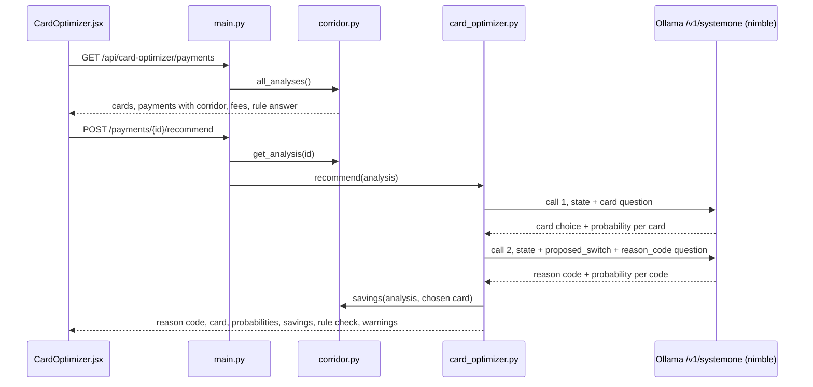
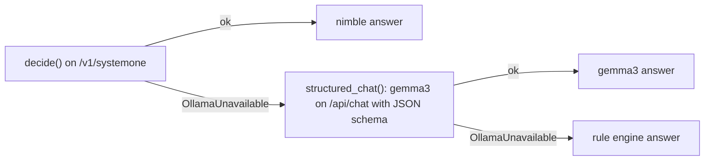

# Card Optimizer Blueprint

Review guide for the Card Optimizer module (branch `card-optimizer`). It covers what changed, how a
recommendation is made, exactly what is sent to Ollama's decision API and what comes back, why it is built this
way, and how it is tested. For the whole system see [ARCHITECTURE.md](ARCHITECTURE.md).

Contents

1. [What the module does](#1-what-the-module-does)
2. [Changes on this branch](#2-changes-on-this-branch)
3. [End-to-end flow](#3-end-to-end-flow)
4. [Corridor engine (deterministic)](#4-corridor-engine-deterministic)
5. [Decision API interaction](#5-decision-api-interaction)
6. [How the answer is used](#6-how-the-answer-is-used)
7. [Fallbacks and errors](#7-fallbacks-and-errors)
8. [Design decisions and real-model results](#8-design-decisions-and-real-model-results)
9. [API contract](#9-api-contract)
10. [Tests](#10-tests)
11. [Review checklist and limitations](#11-review-checklist-and-limitations)

---

## 1. What the module does

A treasury team pays foreign suppliers with several corporate cards. Some payments are declined for 3-D Secure
(SCA) challenges or regional blocks; others go through but pay FX markups and cross-border fees. For each payment
the Card Optimizer recommends which card to use and returns a programmatic reason code:

| Reason code | Meaning | Example in the mock data |
| --- | --- | --- |
| `SCA_BYPASS_CORRIDOR` | Declined or held for SCA; retry on a card with the corporate SCA exemption in the merchant's region | OVH (FR) declined `1A` on a US card → Irish lodged card |
| `FX_INTERBANK_MATCH` | Most of the saving comes from the FX fee; use a card that holds the currency | Bloomberg (GBP) on a US card → UK card |
| `INTER-REGIONAL_ROUTING` | Blocked cross-region, or most of the saving comes from the cross-border fee | Atlassian (AU, billed USD) on a US card → Singapore card |
| `NO_CHANGE` | Settled, and no switch saves 10 USD or more | Shopify (CA) |

The **judgement** (which card, which code) is made by the `nimble` decision model through Ollama's decision API.
The **arithmetic** (fees, savings, recovered volume) is done by plain code. A deterministic rule engine gives a
second opinion that is shown next to the model's answer but never replaces it.

## 2. Changes on this branch

Commits on `card-optimizer` since `main`:

| Commit | Change |
| --- | --- |
| `a7cc558` | Add Card Optimizer module: data, corridor engine, gemma3 structured recommendation, API, UI |
| `b183ed0` | Use Ollama's decision API (`/v1/systemone`, `nimble`) with gemma3 and rules as fallbacks |
| `f4624c5` | Precomputed facts and a NO_CHANGE override (reverted in the next commit) |
| `3f55f33` | Let the decision model judge unaided: raw facts only, no overrides |
| `5edbe3f` | Make SCA and inter-regional reason codes describe distinct causes |
| `1548ef4` | Separate FX and inter-regional reason codes by cause |
| `3e1193d` | Add `scripts/check_card_decisions.py` to compare nimble with the rules |
| `3d4e5e8` | Two-step decision: pick the card, then classify the switch |
| `d21d6f0` | Show nimble the FX and cross-border parts of each switch's saving |

Files:

| File | Status | Purpose |
| --- | --- | --- |
| `backend/app/data/transactions/cross_border.py` | rewritten | 8 messy cross-border payments, 5-card portfolio, regions, alpha-3 map, mock FX rates |
| `backend/app/services/corridor.py` | new | Normalise, corridor, friction, per-card fees and eligibility, rule answer, savings |
| `backend/app/services/card_optimizer.py` | new | Builds the decision requests, runs the two-step decision, fallbacks, response |
| `backend/app/services/ollama_client.py` | changed | `decide()` for `/v1/systemone`; `structured_chat()` for gemma3 `/api/chat`; decision model in status |
| `backend/app/config.py` | changed | `OLLAMA_NIMBLE_PATH`, new `OLLAMA_DECISION_MODEL` (default `nimble`) |
| `backend/app/main.py` | changed | `/api/card-optimizer/*` routes; module unlocked; decision model in `/api/health` |
| `frontend/src/modules/CardOptimizer.jsx` | new | Totals, payment queue, recommendation with probability bars, card options table |
| `frontend/src/App.jsx`, `api.js`, `components/Header.jsx` | changed | Tab unlocked, API calls, nimble in the status badge |
| `backend/tests/*` | new | 45 tests (section 10) |
| `scripts/check_card_decisions.py` | new | Runs all payments through the live backend and prints model vs rules |
| `README.md`, `docs/ARCHITECTURE.md`, `.env.example`, `docker-compose.yml` | changed | Setup (`ollama pull nimble`, Ollama 0.35+), config, docs |

## 3. End-to-end flow



If nimble keeps the current card in call 1, the answer is `NO_CHANGE` and call 2 is skipped.

## 4. Corridor engine (deterministic)

`corridor.py` turns each raw payment into facts. Nothing here calls a model.

1. **Normalise.** `DEU` → `DE`, `eur` → `EUR`, `"76,500"` → `76500.0`, then `amount_usd` from `FX_RATES_USD`.
2. **Fees per card** (`card_cost`). FX fee is 0 if the card holds the payment currency, else its `fx_fee_bps`.
   Cross-border fee applies when the card's issuer region differs from the merchant's.
   `fee_usd = amount_usd × (fx_bps + cross_border_bps) / 10,000`.
3. **Friction** (`friction`). SCA challenge: decline code `1A` or `65`, or "3ds", "sca", "authentication" in the
   text. Regional block: code `05`, `57`, `62`, or "block" (takes precedence). Failed: status isn't `SETTLED`.
4. **Eligibility** (`card_options`). A card can't work if it already failed, if the SCA challenge would recur (no
   exemption in the merchant's region), or if a regional block would recur. Used by the rule engine and the UI's
   card table, **not sent to nimble**.
5. **Rule answer** (`rule_recommendation`). Cheapest eligible card, then SCA → `SCA_BYPASS_CORRIDOR`; block →
   `INTER-REGIONAL_ROUTING`; saving under 10 USD → `NO_CHANGE`; FX removed → `FX_INTERBANK_MATCH`; else
   `INTER-REGIONAL_ROUTING`.
6. **Savings** (`savings`). Fees saved = current card fee − chosen card fee. Recovered = the payment's USD amount
   when a failed payment is moved to an eligible card.

## 5. Decision API interaction

### Endpoint

| | |
| --- | --- |
| URL | `POST {OLLAMA_BASE_URL}{OLLAMA_NIMBLE_PATH}` = `http://host.docker.internal:11434/v1/systemone` |
| Requires | Ollama 0.35+, `ollama pull nimble` (9B, about 9.4 GB) |
| Model | `OLLAMA_DECISION_MODEL`, default `nimble` |
| Code | `ollama_client.decide(state, questions)` returns the `answers` object |
| Limits | 2 to 26 options per choice question; whole prompt within nimble's 8,192-token context; body up to 64 KiB |

A decision model only picks from the options it is given and returns a probability for each. It writes no text,
so the action and rationale shown in the UI are written by code from the facts.

### Request structure

```
{
  "model":     "nimble",
  "state":     { ... },     // the facts nimble judges from (JSON object)
  "questions": {            // named questions; here exactly one per call
    "<name>": {
      "type":         "choice",
      "instructions": "<the question>",
      "criteria":     { "<option id>": "<description of the option>", ... }
    }
  }
}
```

`state` fields (from `card_optimizer._state`):

| Field | Content | Why it's there |
| --- | --- | --- |
| `payment` | merchant, MCC, amount, currency, amount_usd, status, decline_code, decline_text, memo | The raw evidence, as the issuer sent it |
| `corridor` | "card issued in US (NA), merchant in GB (EU)" | Issuer and merchant regions in words |
| `current_card` | Card name | What it was paid or attempted on |
| `current_card_fees` | "3.00% FX + 1.00% cross-border = 246.38 USD" | So nimble can see what the current card costs |
| `proposed_switch` (call 2 only) | from/to card descriptions, FX and cross-border fee change, saving per fee and total in USD | The concrete switch nimble is classifying |

Not sent: the rule answer, the eligibility verdicts, friction flags, or any "best card" label.

### Call 1: which card

Real request for Bloomberg (`txn_xb_06`, 4,850 GBP settled on a US Visa):

```json
{
  "model": "nimble",
  "state": {
    "payment": {"merchant": "Bloomberg L.P.", "mcc": "7375", "amount": 4850.0, "currency": "GBP",
                "amount_usd": 6159.5, "status": "SETTLED", "decline_code": null, "decline_text": null,
                "memo": "Terminal seat, London desk"},
    "corridor": "card issued in US (NA), merchant in GB (EU)",
    "current_card": "Visa Corporate ****4471",
    "current_card_fees": "3.00% FX + 1.00% cross-border = 246.38 USD"
  },
  "questions": {
    "card": {
      "type": "choice",
      "instructions": "Which company card should this payment be retried or paid on? Choose the card that fixes the problem at the lowest fee. A card that already failed on this payment won't work.",
      "criteria": {
        "card_us_visa": "Visa Corporate ****4471 (current card): issued in US (NA), holds USD, corporate SCA exemption: no, fees on this payment 3.00% FX + 1.00% cross-border = 246.38 USD",
        "card_us_mc": "Mastercard Corporate ****0928: issued in US (NA), holds USD, corporate SCA exemption: no, fees on this payment 2.75% FX + 1.00% cross-border = 230.98 USD, 15.40 USD less than the current card",
        "card_eu_lodged": "Mastercard Lodged Virtual (IE) ****3310: issued in IE (EU, same region as the merchant), holds EUR, corporate SCA exemption: yes, fees on this payment 2.00% FX + 0.00% cross-border = 123.19 USD, 123.19 USD less than the current card",
        "card_uk_visa": "Visa Commercial (UK) ****5562: issued in GB (EU, same region as the merchant), holds GBP, corporate SCA exemption: yes, fees on this payment 0.00% FX + 0.00% cross-border = 0.00 USD, 246.38 USD less than the current card",
        "card_sg_multi": "Visa Multi-Currency (SG) ****7781: issued in SG (APAC), holds SGD/USD/AUD/JPY/INR, corporate SCA exemption: no, fees on this payment 1.50% FX + 0.70% cross-border = 135.51 USD, 110.87 USD less than the current card"
      }
    }
  }
}
```

For a failed payment the current card's description ends with ", already declined on this payment" (or
"already pending auth").

Response from the real nimble (rounded):

```json
{
  "model": "nimble",
  "answers": {
    "card": {"type": "choice", "choice": "card_uk_visa",
             "probabilities": {"card_us_visa": 0.0002, "card_us_mc": 0.0003, "card_eu_lodged": 0.0089,
                               "card_uk_visa": 0.9904, "card_sg_multi": 0.0002}}
  }
}
```

### Call 2: what the switch fixes

Same `state` plus `proposed_switch`, and the reason-code question:

```json
{
  "model": "nimble",
  "state": {
    "payment": {"...": "as in call 1"},
    "corridor": "card issued in US (NA), merchant in GB (EU)",
    "current_card": "Visa Corporate ****4471",
    "current_card_fees": "3.00% FX + 1.00% cross-border = 246.38 USD",
    "proposed_switch": {
      "from": "Visa Corporate ****4471 (current card): issued in US (NA), holds USD, corporate SCA exemption: no, fees on this payment 3.00% FX + 1.00% cross-border = 246.38 USD",
      "to": "Visa Commercial (UK) ****5562: issued in GB (EU, same region as the merchant), holds GBP, corporate SCA exemption: yes, fees on this payment 0.00% FX + 0.00% cross-border = 0.00 USD, 246.38 USD less than the current card",
      "fx_fee": "3.00% -> 0.00%",
      "fx_fee_saving_usd": 184.78,
      "cross_border_fee": "1.00% -> 0.00%",
      "cross_border_fee_saving_usd": 61.59,
      "total_saving_usd": 246.38
    }
  },
  "questions": {
    "reason_code": {
      "type": "choice",
      "instructions": "This payment is being moved to the proposed card. Which reason code describes what the switch fixes?",
      "criteria": {
        "SCA_BYPASS_CORRIDOR": "The payment was declined or is held for 3-D Secure / SCA authentication (for example code 1A or 65, or a pending 3DS challenge), and the switch moves it to a card with the corporate SCA exemption in the merchant's region, so no challenge is raised.",
        "FX_INTERBANK_MATCH": "The payment went through and most of the switch's saving comes from the FX fee: fx_fee_saving_usd is larger than cross_border_fee_saving_usd, because the proposed card holds the payment currency. Total saving 10 USD or more.",
        "INTER-REGIONAL_ROUTING": "The payment was blocked as a cross-region payment (for example code 05), or it went through and most of the switch's saving comes from the cross-border fee: cross_border_fee_saving_usd is larger than fx_fee_saving_usd, because the proposed card is issued in the merchant's region. Total saving 10 USD or more.",
        "NO_CHANGE": "The payment went through and the switch saves less than 10 USD, so it isn't worth changing cards."
      }
    }
  }
}
```

Response from the real nimble:

```json
{
  "model": "nimble",
  "answers": {
    "reason_code": {"type": "choice", "choice": "FX_INTERBANK_MATCH", "confidence": 0.51,
                    "probabilities": {"SCA_BYPASS_CORRIDOR": 0.392, "FX_INTERBANK_MATCH": 0.607,
                                      "INTER-REGIONAL_ROUTING": 0.001, "NO_CHANGE": 0.0002}}
  }
}
```

### Field mapping

| Response field | Used as | Shown in the UI |
| --- | --- | --- |
| `answers.card.choice` | `recommended_card_id` | Card name next to the reason code; highlighted row in the card table |
| `answers.card.probabilities` | `card_probabilities` | Returned by the API (not drawn yet) |
| `answers.reason_code.choice` | `reason_code` | Reason-code tag in the queue and on the recommendation |
| `answers.reason_code.probabilities` | `probabilities` | "Decision probabilities" bars |
| `answers.reason_code.confidence` | `confidence` | Returned by the API (bars are shown instead) |

## 6. How the answer is used

`card_optimizer.recommend` treats nimble's answer as final:

- **Rule check.** `agrees_with_rules` is true when the code matches the rule's and, unless the code is
  `NO_CHANGE`, the card matches too. A disagreement shows an amber "Rule check disagrees" note with the rule's
  answer. Nothing is overwritten.
- **Can't-work warning.** If nimble picks a card the corridor engine says can't clear the friction (for example
  a US card for an SCA decline), a warning names the issue and `recovered_usd` is 0.
- **Action and rationale.** Written from the facts by `_explain`, for example "Retry on Mastercard Lodged Virtual
  (IE) ****3310 under the secure corporate payment exemption."
- **Money.** `fees_saved_usd` and `recovered_usd` come from `corridor.savings` for nimble's chosen card.

## 7. Fallbacks and errors



| Situation | Error raised by `decide()` | Result |
| --- | --- | --- |
| 404 with "model" in body | "Decision model 'nimble' is not installed. Run: ollama pull nimble" | gemma3 fallback, note shown |
| 404 otherwise | "Ollama doesn't serve /v1/systemone; the decision API needs Ollama 0.35 or newer" | gemma3 fallback, note shown |
| Other non-200 | "Ollama /v1/systemone returned {status}: {body}" | gemma3 fallback |
| No `answers` for a question | "/v1/systemone returned no answers for card" | gemma3 fallback |
| Connection refused | "Ollama is unreachable at …" | gemma3, then rules |

The gemma3 fallback asks for `reason_code` (enum of the four codes) and `recommended_card_id` (enum of card ids)
in one JSON-schema call at temperature 0. Every recommendation returns `source`, `model`, `route` and `notes`,
so the UI shows which path answered and why.

## 8. Design decisions and real-model results

Results of `scripts/check_card_decisions.py` against the real nimble:

| Version | Request design | Agreement with rules | What went wrong |
| --- | --- | --- | --- |
| `3f55f33` to `1548ef4` | One call, both questions; reason question "what is wrong with this payment?" | 5/8 | Every settled payment came back `NO_CHANGE` (Bloomberg 0.96), although nimble's own card pick saved 246 USD |
| `3d4e5e8` | Two calls: card, then "what does this switch fix?" | (reported) | Payments saving on both fees came back `INTER-REGIONAL_ROUTING` |
| `d21d6f0` | Switch shows FX and cross-border saving separately | **8/8** | Bloomberg correct at 0.61, with 0.39 on SCA |

Decisions:

1. **Facts, not answers.** nimble sees what an analyst would see: decline text, countries, what each card holds,
   its exemption and fees. It never sees the rule answer, eligibility verdicts or a "best card" label. Tests
   enforce this (section 10).
2. **Two calls.** nimble scores each question independently and on its own, "what's wrong?" judged mostly from
   the status: settled read as fine. Asking about a concrete switch, after nimble picked the card, gave it a
   question it answers well. Call 1 was already right for 8/8 payments.
3. **Arithmetic is done for it.** A decision model compares, it doesn't calculate. So fees, fee differences and
   the FX/cross-border split are given as numbers; which reason they add up to is nimble's call.
4. **No overrides.** The rule engine is a visible second opinion. An earlier version replaced a contradicting
   `NO_CHANGE` with the rule's answer; that was removed so the demo shows nimble's real judgement.
5. **One question per call.** The API accepts up to 64 questions per call, but the reason question depends on the
   card answer, so they can't share a call.

## 9. API contract

`GET /api/card-optimizer/payments` returns `{cards, payments, recommendations}`. Each payment:

```json
{
  "transaction": {"id": "txn_xb_06", "merchant": "Bloomberg L.P.", "amount": 4850.0, "currency": "GBP",
                  "amount_usd": 6159.5, "status": "SETTLED", "card_id": "card_us_visa", "...": "..."},
  "corridor": {"issuer_country": "US", "merchant_country": "GB", "issuer_region": "NA", "merchant_region": "EU",
               "cross_border": true, "inter_regional": true},
  "signals": {"sca_challenge": false, "regional_block": false, "failed": false},
  "tags": [{"label": "FX fee 3.00%", "tone": "amber"}, {"label": "Cross-border 1.00%", "tone": "amber"}],
  "current_fee_usd": 246.38,
  "options": [{"card_id": "card_uk_visa", "fx_bps": 0, "cross_border_bps": 0, "fee_usd": 0.0,
               "eligible": true, "issues": [], "...": "..."}],
  "rule": {"reason_code": "FX_INTERBANK_MATCH", "card_id": "card_uk_visa", "why": "cheapest eligible card (0.00 USD)"}
}
```

`POST /api/card-optimizer/payments/{id}/recommend` returns:

```json
{
  "transaction_id": "txn_xb_06",
  "reason_code": "FX_INTERBANK_MATCH",
  "recommended_card_id": "card_uk_visa",
  "recommended_card": "Visa Commercial (UK) ****5562",
  "action": "Pay Bloomberg L.P. from Visa Commercial (UK) ****5562, which holds GBP.",
  "rationale": "Settled with 3.00% FX and 1.00% cross-border fees (246.38 USD) on Visa Corporate ****4471. …",
  "confidence": 0.51,
  "probabilities": {"FX_INTERBANK_MATCH": 0.607, "SCA_BYPASS_CORRIDOR": 0.392, "...": "..."},
  "card_probabilities": {"card_uk_visa": 0.990, "...": "..."},
  "source": "decision model", "model": "nimble", "route": "/v1/systemone", "notes": [],
  "rule": {"reason_code": "FX_INTERBANK_MATCH", "card_id": "card_uk_visa", "why": "…"},
  "agrees_with_rules": true,
  "warnings": [],
  "fees_saved_usd": 246.38,
  "recovered_usd": 0.0
}
```

Unknown id returns 404. Recommendations are kept in memory (`RECOMMENDATIONS` in `main.py`).

## 10. Tests

Run from `backend/`; no Ollama needed (every model call is faked):

```bash
cd backend
pip install -r requirements-dev.txt
python -m pytest -q
```

45 tests:

| File | What it covers |
| --- | --- |
| `tests/test_corridor.py` | Normalising the messy feed; FX and cross-border fee rules; reading decline codes and text; eligibility reasons; the rule answer for all 8 payments; savings and recovered volume |
| `tests/test_decision_api.py` | The HTTP contract with `/v1/systemone` (path, `model`/`state`/`questions` body, `answers` returned) via `httpx.MockTransport`; 404 for a missing model vs an old Ollama; missing answers; unreachable Ollama |
| `tests/test_card_optimizer.py` | Card options carry facts only (no "best", "eligible" or "can work" hints); the state excludes the rule answer; the two-call flow and the exact `proposed_switch` numbers for Bloomberg; keeping the current card is `NO_CHANGE` with one call; a disagreement is shown, not corrected; a can't-work card is flagged and recovers nothing; gemma3 and rules fallbacks; every payment returns a complete recommendation |
| `tests/test_api.py` | `GET /payments` shape, `POST /recommend` stores the result, unknown id 404, Liquidity Guard still 423 |

Against the real model, with the app running:

```bash
python3 scripts/check_card_decisions.py
```

prints nimble's choice, the rule answer and the probabilities per payment, and writes the full responses to
`scripts/card_decisions.json` (git-ignored).

## 11. Review checklist and limitations

Review points:

1. Card descriptions and reason-code criteria in `card_optimizer.py` (`_card_line`, `REASON_CRITERIA`): do they
   read as facts and definitions, not hints?
2. The rule priority in `corridor.rule_recommendation` (SCA, then block, then 10 USD threshold, then FX).
3. The mock portfolio and fees in `cross_border.py`.
4. Whether to draw `card_probabilities` in the UI as well.

Limitations:

- nimble is confident on 7 of 8 payments; Bloomberg is 0.61 vs 0.39 (SCA), likely pulled by the UK card's
  "corporate SCA exemption: yes". Rerun the check script after any wording change.
- Two decision calls per payment (nimble reports about 90 ms each on Apple Silicon); "Analyze all payments" runs
  them one payment at a time.
- FX rates, card fees and the 10 USD threshold are mock values. Recommendations are in memory.
- The gemma3 fallback is a single structured call, not the two-step flow.
