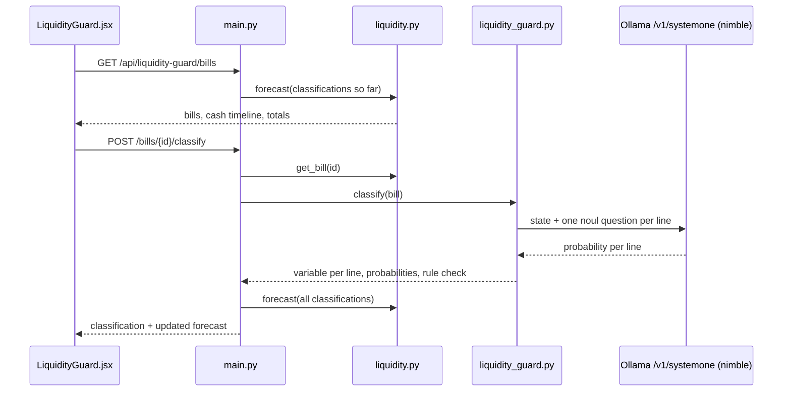
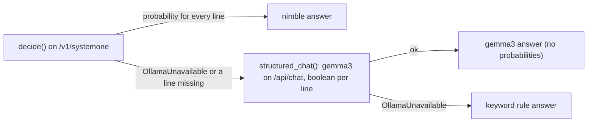

# Liquidity Guard Blueprint

Guide to the Liquidity Guard module: how upcoming auto-debits are classified and forecast, exactly what is sent to
Ollama's decision API and what comes back, and how it is tested. For the whole system see
[ARCHITECTURE.md](ARCHITECTURE.md).

Contents

1. [What the module does](#1-what-the-module-does)
2. [End-to-end flow](#2-end-to-end-flow)
3. [Bills and the forecast engine (deterministic)](#3-bills-and-the-forecast-engine-deterministic)
4. [Decision API interaction](#4-decision-api-interaction)
5. [How the answer is used](#5-how-the-answer-is-used)
6. [Fallbacks and errors](#6-fallbacks-and-errors)
7. [API contract](#7-api-contract)
8. [Tests](#8-tests)

---

## 1. What the module does

Cloud, data and ad vendors bill on usage and auto-debit a bank account a few days after the cycle closes.
Late in the month the statement shows only what has been used so far, so a treasury team that reads "billed so
far" as "what will be charged" is surprised when the debit lands. The Liquidity Guard asks, for every line on
every upcoming bill: **is this a variable usage-based consumption line?**

- **Yes** (compute hours, data transfer, tokens, impressions, clicks): the amount will keep growing to the end of
  the cycle, so it is run-rated.
- **No** (seats, licences, memberships, commitments): the amount is the charge.

The **judgement** (variable or not, per line) is made by the `nimble` decision model through Ollama's decision
API, as a probability. The **arithmetic** (run-rate, timeline, buffer) is plain code. A keyword rule gives a second
opinion that is shown on each line but never replaces the model's answer.

## 2. End-to-end flow



One decision call per bill. Selecting an account in the UI filters the bill list and cash timeline to that
account, and **Classify all bills** calls the classify route for each of that account's bills in turn. Hovering a
bill's Forecast value shows each line's billed-so-far amount, how it is forecast (not classified, variable × 31 ÷ 27,
or fixed as billed) and the result.

## 3. Bills and the forecast engine (deterministic)

Mock data in `backend/app/data/transactions/recurring.py`, captured on 28 Oct 2026 with 27 of 31 days of the
October cycle elapsed:

| Bill | Auto-debit | Lines (rule view) |
| --- | --- | --- |
| Amazon Web Services | 2 Nov | EC2 on-demand, data transfer, Bedrock tokens, Business Support (10% of usage): variable; Compute Savings Plan: fixed |
| Google Cloud | 1 Nov | BigQuery on-demand, GKE pod hours, Cloud Storage: variable; Committed Use Discount: fixed |
| Meta Platforms (Ads) | 3 Nov | Per-1,000-impressions campaign, per-click campaign: variable |
| Google Ads | 4 Nov | Per-click search campaign, per-1,000-impressions display: variable |
| LinkedIn | 6 Nov | Per-1,000-impressions sponsored content: variable; Sales Navigator seats: fixed |
| Snowflake | 5 Nov | Compute credits, storage: variable; capacity commitment: fixed |
| Twilio | 2 Nov | SMS segments: variable; phone numbers at $1.15/number/month: fixed |
| Datadog | 3 Nov | On-demand hosts above commitment, log ingestion: variable; 150 committed hosts: fixed |
| Slack, Salesforce, coworking office | 14 Nov, 1 Nov, 1 Nov | Seats, licences, desks: fixed |

Each bill debits one of three accounts:

| Account | Opening balance | Minimum buffer | Bills and flows |
| --- | --- | --- | --- |
| Operating account ****2210 | 240,000 USD | 75,000 USD | Google Cloud, Snowflake, Salesforce, coworking office (ACH); payroll 98,000 out on 1 Nov; customer receipt 45,000 in on 4 Nov |
| Card settlement ****7731 | 135,000 USD | 60,000 USD | AWS, Twilio, Datadog, Slack (auto-paid card statements) |
| Marketing account ****4408 | 70,000 USD | 20,000 USD | Meta Ads, Google Ads, LinkedIn |

Amounts arrive as strings with separators and are parsed first.

`liquidity.py`:

- `project(line, variable)`: a variable line is `mtd × 31 / 27`; a fixed or not yet classified line is its
  month-to-date amount.
- A variable line forecast above `SPIKE_RATIO` (1.25) × its three-cycle average is a **spike**.
- `forecast(classifications)` builds a timeline for each account: its debits and flows sorted by date (outflows
  before inflows on the same day, so the low point is never understated), applied to its opening balance, with the
  balance after each event, whether it is below the account's buffer, the low point and the first breach.

| State | Operating low point | Card settlement low point | Marketing low point | Accounts below buffer |
| --- | --- | --- | --- | --- |
| No bills classified (debits 165,758.30, billed so far) | 108,337.45 on 1 Nov | 64,154.25 on 14 Nov | 22,760.00 on 6 Nov | none |
| All bills classified as the rule does (debits 185,405.76, variable exposure 152,267.76) | 106,049.66 on 1 Nov | 54,794.58 on 14 Nov, below buffer from 3 Nov | 15,909.63 on 6 Nov, below buffer from 6 Nov | 2 of 3 |

That is the demo: before classification every account looks safe; once the usage lines are recognised, card
settlement falls below its buffer on 3 Nov and marketing on 6 Nov. In the UI each account card shows a donut of
its bills (amounts starred while not classified) that grows as the bills are classified.

## 4. Decision API interaction

### Endpoint

| | |
| --- | --- |
| URL | `POST {OLLAMA_BASE_URL}{OLLAMA_NIMBLE_PATH}` = `http://host.docker.internal:11434/v1/systemone` |
| Requires | Ollama 0.35+, `ollama pull nimble` (same model as the Card Optimizer) |
| Model | `OLLAMA_DECISION_MODEL`, default `nimble` |
| Code | `ollama_client.decide(state, questions)` returns the `answers` object |
| Limits | Whole prompt within nimble's 8,192-token context; body up to 64 KiB. The largest bill (AWS, 5 lines) is well inside both |

### Request structure

`noul` questions ask for a probability that a statement is true. Each line of the bill is one named question, so
one call classifies the whole bill and nimble scores each line independently.

```
{
  "model":     "nimble",
  "state":     { ... },           // the bill the lines belong to
  "questions": {                  // one per invoice line, named by line id
    "<line id>": {
      "type":         "noul",
      "instructions": "<invoice line text, history, billed so far> Is this a variable usage-based consumption line?"
    },
    ...
  }
}
```

`state` fields (from `liquidity_guard._state`):

| Field | Content | Why it's there |
| --- | --- | --- |
| `vendor` | "Datadog, Inc." | Context for the line text |
| `descriptor` | "DATADOG INC NEW YORK" | The bank descriptor, as it will appear on the debit |
| `auto_debit_date` | "2026-11-03" | When the charge lands |
| `definition` | What counts as a variable usage-based consumption line, and that seats, licences and commitments don't, even on a cloud bill | So every question is judged against the same definition |

Each question's `instructions` (from `_line_text`) hold the invoice line text as printed, the last three
cycles' charges, and the amount billed so far after 27 of 31 days. Not sent: the rule answer, its reason, the
spike flag or any forecast.

### Example: Datadog

Request:

```json
{
  "model": "nimble",
  "state": {
    "vendor": "Datadog, Inc.",
    "descriptor": "DATADOG INC NEW YORK",
    "auto_debit_date": "2026-11-03",
    "definition": "A variable usage-based consumption line is charged by metered usage (compute hours, data transferred or stored, queries, requests, tokens, credits, messages, impressions or clicks), so the amount moves with consumption. A fixed seat, licence, membership, subscription or committed fee is not, even when it appears on a cloud bill."
  },
  "questions": {
    "dd_hosts": {
      "type": "noul",
      "instructions": "Invoice line: \"Infrastructure Pro - 150 committed hosts, annual plan\". Last 3 cycles: $3,450.00, $3,450.00, $3,450.00. This cycle so far: $3,450.00 after 27 of 31 days. Is this a variable usage-based consumption line?"
    },
    "dd_ondemand": {
      "type": "noul",
      "instructions": "Invoice line: \"Infrastructure Pro - on-demand hosts above commitment, billed hourly\". Last 3 cycles: $410.00, $620.00, $540.00. This cycle so far: $1,288.00 after 27 of 31 days. Is this a variable usage-based consumption line?"
    },
    "dd_logs": {
      "type": "noul",
      "instructions": "Invoice line: \"Log Management - ingestion, 38.2 TB @ $0.10/GB\". Last 3 cycles: $2,900.00, $3,100.00, $3,350.00. This cycle so far: $3,820.00 after 27 of 31 days. Is this a variable usage-based consumption line?"
    }
  }
}
```

Response (shape; the probabilities are nimble's own):

```json
{
  "answers": {
    "dd_hosts":    {"type": "noul", "noul": 0.04},
    "dd_ondemand": {"type": "noul", "noul": 0.91},
    "dd_logs":     {"type": "noul", "noul": 0.96}
  },
  "usage": {"...": "..."}
}
```

`dd_ondemand` is the hard case: it says "commitment" but is the usage above it. The rule handles it by checking
strong usage markers first; nimble has to read it from the text.

### Field mapping

| Response field | Used as | Shown in the UI |
| --- | --- | --- |
| `answers.<line id>.noul` | `lines.<line id>.probability`; `variable = probability ≥ 0.5` | VARIABLE / FIXED tag and the nimble probability bar on the line |

## 5. How the answer is used

`liquidity_guard.classify` treats nimble's answer as final:

- **Forecast method.** `variable` decides whether `project()` run-rates the line. Every total, the cash timeline
  and the breach date follow from that.
- **Rule check.** Each line carries `rule` (`variable`, `why`) and `agrees_with_rules`. A disagreement shows the
  rule's view on the line ("rule says fixed"). Nothing is overwritten.
- **Bill tags.** "N variable", "N variable · spike" or "all fixed" in the bill queue; "not classified" until the
  bill has been sent to nimble.

## 6. Fallbacks and errors



| Situation | Result |
| --- | --- |
| 404 with "model" in body (nimble not pulled) | gemma3 fallback, note "Run: ollama pull nimble" |
| 404 otherwise (Ollama older than 0.35) | gemma3 fallback, note says the decision API needs Ollama 0.35+ |
| nimble answers without a probability for some line | gemma3 fallback, note "returned no probability for some lines" |
| Ollama unreachable | gemma3 fails too; the rule answer is used, "rules (models unavailable)" |

The gemma3 fallback sends the same line text with a JSON schema of one required boolean per line id. Every
classification returns `source`, `model`, `route` and `notes`, so the UI shows which path answered and why.

## 7. API contract

`GET /api/liquidity-guard/bills` returns `{forecast, classifications}`. `forecast`:

```json
{
  "analysis_date": "2026-10-28",
  "cycle": {"start": "2026-10-01", "end": "2026-10-31", "days": 31, "days_elapsed": 27},
  "accounts": [{
    "id": "acct_cards", "name": "Card settlement (USD) ****7731", "purpose": "Auto-pays the Visa and Mastercard statements",
    "balance": 135000.0, "currency": "USD", "minimum_buffer": 60000.0,
    "bill_ids": ["bill_aws", "bill_twilio", "bill_datadog", "bill_slack"], "debits": 80205.42, "unclassified_bills": 0,
    "timeline": [{"date": "2026-11-02", "label": "Amazon Web Services auto-debit", "amount": -56792.75, "kind": "bill",
                  "bill_id": "bill_aws", "estimate": false, "balance_after": 78207.25, "below_buffer": false}],
    "low_point": {"balance": 54794.58, "date": "2026-11-14"}, "first_breach": "2026-11-03"
  }],
  "bills": [{
    "id": "bill_meta", "account_id": "acct_marketing", "vendor": "Meta Platforms (Ads)", "descriptor": "FACEBK *ADS 9QZ3KL4", "debit_date": "2026-11-03",
    "classified": true, "projected": 33043.7, "billed_so_far": 28780.0, "avg3": 11450.0, "change_pct": 188.6,
    "variable_lines": 2, "spike": true,
    "lines": [{"id": "meta_launch", "description": "Campaign 'Q4 Launch' - Advantage+ shopping, billed per 1,000 impressions",
               "mtd": 24600.0, "history": [6200.0, 7100.0, 8800.0], "avg3": 7366.67,
               "rule": {"variable": true, "why": "priced on metered usage"},
               "variable": true, "projected": 28244.44, "change_pct": 283.4, "spike": true}]
  }],
  "totals": {"debits": 185405.76, "avg3": 110223.67, "change_pct": 68.2, "variable_exposure": 152267.76,
             "surprise": 75182.09, "unclassified_bills": 0, "accounts_below_buffer": ["acct_cards", "acct_marketing"],
             "first_breach": {"date": "2026-11-03", "account_id": "acct_cards"}}
}
```

`variable` is `null` and `estimate` is `true` for a bill that hasn't been classified yet.

`POST /api/liquidity-guard/bills/{id}/classify` returns `{classification, forecast}`:

```json
{
  "classification": {
    "bill_id": "bill_datadog",
    "lines": {
      "dd_hosts":    {"variable": false, "probability": 0.04, "rule": {"variable": false, "why": "seat, licence or commitment pricing"}, "agrees_with_rules": true},
      "dd_ondemand": {"variable": true,  "probability": 0.91, "rule": {"variable": true,  "why": "priced on metered usage"},             "agrees_with_rules": true},
      "dd_logs":     {"variable": true,  "probability": 0.96, "rule": {"variable": true,  "why": "billed in usage units"},               "agrees_with_rules": true}
    },
    "source": "decision model", "model": "nimble", "route": "/v1/systemone", "notes": [], "agreements": 3
  },
  "forecast": {"...": "the whole forecast, as above"}
}
```

Unknown id returns 404. Classifications are kept in memory (`CLASSIFICATIONS` in `main.py`).
`DELETE /api/liquidity-guard/classifications` clears them and returns `{"cleared": n}`; the UI's **Reset**
button calls it.

## 8. Tests

Run from `backend/`; no Ollama needed (every model call is faked):

```bash
cd backend
pip install -r requirements-dev.txt
python -m pytest -q
```

| File | What it covers |
| --- | --- |
| `tests/test_liquidity.py` | The rule on all 26 lines, including on-demand above a commitment; parsing the string amounts; run-rate for variable lines only; every bill on one account; the unclassified forecast (no breach) and the classified one (card settlement below buffer on 3 Nov, marketing on 6 Nov, operating safe, exact totals); timeline order and running balance per account; payroll and receipts on the operating account only; estimates for unclassified bills; one `noul` question per line with no rule answer in the request; the 0.5 threshold; a disagreement shown, not corrected; a missing line falls back to gemma3; no models falls back to the rule |
| `tests/test_api.py` | Liquidity Guard listed as live; bills start unclassified; classify stores the result and updates the forecast; reset clears it; unknown bill 404 |

Against the real model, with the app running:

```bash
python3 scripts/check_liquidity_decisions.py
```

clears earlier classifications, classifies every bill, prints nimble's probability and the rule's answer for each
line and the forecast they add up to, and writes the full responses to `scripts/liquidity_decisions.json`
(git-ignored).
